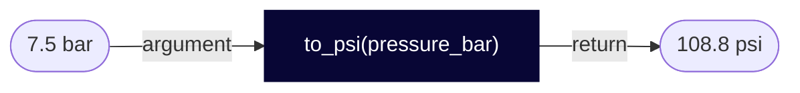
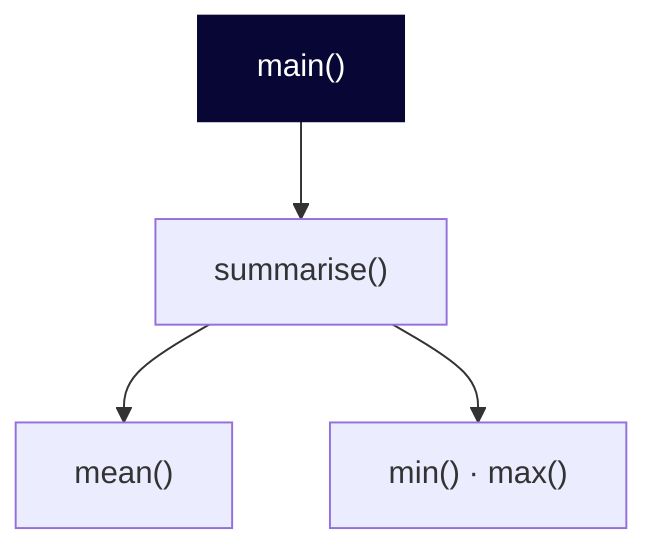

# Language <span class="dm-accent">fundamentals</span>

<!--
The biggest block of the day. Variables, types, collections, control flow and functions, each followed by an exercise. All examples use compressor test-bench data, and all numbers are made up.
-->

---
layout: default
label: 3 · Language fundamentals
---

# Variables are <span class="dm-accent">names</span> for values

<div class="split">
<div>

```python {all|1-3|5|6-7|all}
pressure_bar = 7.5
temperature_c = 82.3
run_id = "TB-014"

pressure_bar = 8.0
print(pressure_bar)
print(temperature_c)
```

<v-click>

```text
8.0
82.3
```

</v-click>
</div>

<div class="names" v-click>
  <div class="row"><span class="name">pressure_bar</span><span class="arrow old">⇢</span><span class="val old">7.5</span></div>
  <div class="row"><span class="name"></span><span class="arrow">→</span><span class="val now">8.0</span></div>
  <div class="row"><span class="name">temperature_c</span><span class="arrow">→</span><span class="val">82.3</span></div>
  <div class="row"><span class="name">run_id</span><span class="arrow">→</span><span class="val">"TB-014"</span></div>
</div>
</div>

<p class="note"><code>=</code> is <b>assignment</b>: it gives a value a name.</p>

<p class="ask" v-click><b>Question</b>After <code>pressure_bar = 8.0</code>, what happens to the bytes that held 7.5?</p>

<style>
.slidev-code { font-size: 17px !important; line-height: 1.5 !important; }
.names { display: flex; flex-direction: column; gap: 12px; }
.names .row { display: flex; align-items: center; gap: 12px; }
.names .name { width: 150px; text-align: center; font-family: monospace; font-size: 15px; color: #fff; background: var(--dm-premium); border-radius: 99px; padding: 6px 0; }
.names .name:empty { background: none; }
.names .arrow { color: var(--dm-connecting); font-size: 22px; }
.names .val { min-width: 90px; text-align: center; font-family: monospace; font-size: 16px; padding: 6px 12px; border-radius: 6px; background: var(--dm-authentic); border: 1.5px solid var(--dm-connecting); color: var(--dm-premium); }
.names .now { font-weight: 700; border-width: 2.5px; }
.names .old { opacity: 0.45; border-style: dashed; text-decoration: line-through; }
.names .arrow.old { border: none; background: none; text-decoration: none; }
</style>

<!--
The equals sign does not mean mathematical equality, it means: give this value this name. No declaration, no type, no semicolon, no end keyword. Assigning again to the same name simply points it at a new value. Compared with MATLAB, there is no output echo: nothing prints unless you call print. Question on the slide: let them guess first. Nothing points at that 7.5 any more. CPython counts how many names refer to each value, and when the count drops to zero it frees the memory at once. You never free memory yourself in Python. This is called garbage collection.
-->

---
layout: default
label: 3 · Language fundamentals
---

# Every value has a <span class="dm-accent">type</span>

<p class="why"><b>Why</b>The type decides what an operation does: <code>7 + 5</code> is 12, <code>"7" + "5"</code> is "75".</p>

```python
run_id = "TB-014"       # str: text, a string
cycles = 12             # int: whole number
flow_l_s = 18.4         # float: decimal number
is_stable = True        # bool: True or False
operator = None         # None: no value (yet)

print(type(flow_l_s))
```

```text
<class 'float'>
```

<style>
.slidev-code { font-size: 17px !important; line-height: 1.5 !important; }
</style>

<!--
Every value has a type, and the type decides what you can do with it. Text is str, whole numbers int, decimals float, and truth values bool. None is the explicit "nothing here yet". Python works out the type from the value, so you do not declare it. In MATLAB nearly everything is a double matrix, here the distinction matters from the start.
-->

---
layout: default
label: 3 · Language fundamentals
---

# Text that looks like a number is <span class="dm-accent">still text</span>

```python {all|1-3|5-6|all}
text = "7.5"
pressure_bar = float(text)
print(pressure_bar + 1)        # 8.5

count = 3
print("Cycles: " + count)
```

<v-click>

```text
TypeError: can only concatenate str (not "int") to str
```

</v-click>

<p class="note"><code>float(text)</code> <b>converts</b> text to a number. Python never converts for you.</p>

<p class="ask" v-click><b>Question</b><code>"7.5" * 2</code> gives no error. What does it print?</p>

<style>
.slidev-code { font-size: 17px !important; line-height: 1.5 !important; }
</style>

<!--
Text read from a file or typed by a user is always a string, even if it looks like a number. Use float, int and str to convert. Python does not convert silently: adding text and a number is an error, and that is a feature. Here is our first error message, notice that it tells you the kind of error and what went wrong. We read a full one just before the exercise. Question on the slide: it prints 7.57.5. On text, the star repeats. So a wrong type does not always crash: sometimes it gives a wrong result, which is worse.
-->

---
layout: default
label: 3 · Language fundamentals
---

# <span class="dm-accent">f-strings</span> put values inside text

<p class="why"><b>Why</b>Every result you report is text with numbers in it: a log line, a file name, a plot title. An f-string sets the decimals and the unit in one place.</p>

```python {all|3|4|all}
run_id = "TB-014"
pressure_bar = 7.5
print(f"Run {run_id}: {pressure_bar:.1f} bar")
print(f"{pressure_bar * 14.5038:.0f} psi")
print("TB" in run_id, run_id.lower())
print("12.5 kW".split())
```

<v-click>

```text
Run TB-014: 7.5 bar
109 psi
True tb-014
['12.5', 'kW']
```

</v-click>

<p class="note">A <b>method</b> is a function you call on a value with a dot: <code>run_id.lower()</code></p>

<style>
.slidev-code { font-size: 15px !important; line-height: 1.4 !important; }
</style>

<!--
Put an f before the quote and you can place any expression inside curly braces. After the colon you control the format: .1f means one decimal place, .0f none. Strings also have methods such as lower, upper, strip, split and replace, called with a dot. split cuts a text at the spaces and gives the pieces as a list, which is how you separate a value from its unit. Lists are the next block. Both single and double quotes work, pick one style and stay with it. Why it matters: a number printed as 108.77849999999999 with no unit is how reports go wrong. Formatting is where the reader meets your result.
-->

---
layout: default
label: 3 · Language fundamentals
---

# A comparison gives a <span class="dm-accent">boolean</span>: True or False

```python {all|1-4|5-6|7|8|all}
pressure_bar = 8.7
temperature_c = 82
is_alarm = pressure_bar > 8.5
print(is_alarm, type(is_alarm))
print(pressure_bar > 8.5 and temperature_c > 90)
print(pressure_bar > 8.5 or temperature_c > 90)
print(not is_alarm)
print(7.0 < pressure_bar < 9.0)
```

<v-click>

```text
True <class 'bool'>
False
True
False
True
```

</v-click>

<p class="note">Compare with <code>&gt;</code> <code>&lt;</code> <code>&gt;=</code> <code>&lt;=</code> <code>==</code> <code>!=</code>. Combine with <b>and</b>, <b>or</b>, <b>not</b>. One <code>=</code> assigns, two <code>==</code> compare.</p>

<style>
.slidev-code { font-size: 16px !important; line-height: 1.45 !important; }
</style>

<!--
A boolean, type bool, has two values: True and False, with a capital. You rarely type them yourself. You get them from a comparison, and you can keep the result in a variable, which is how an alarm flag is made. Boolean logic combines them. and is True only when both sides are True. or is True when at least one side is True. not turns True into False. In Python these are words, where MATLAB writes two ampersands, two bars and a tilde. The last line is a Python extra: you can chain comparisons the way you write them in maths, so a range check is one expression. Two things go wrong often. A single equals sign assigns, a double one compares, and mixing them up is the classic error. And when you mix and with or, and is evaluated first: True or False and False is True. Use brackets and nobody has to remember that. The if statement after the break runs on exactly these booleans.
-->

---
layout: default
label: 3 · Language fundamentals
---

# A number has no unit, so put it <span class="dm-accent">in the name</span>

<p class="why"><b>Why</b>Python stores 7.5, not 7.5 bar. Mix bar and psi and you get a wrong number, not an error.</p>

<DmColumns class="mt-2">
<DmColumn header="Written fast" tone="plain">

```python
p = 7.5
t = 82
calc(p, t)
```

</DmColumn>
<DmColumn header="Read easily" tone="violet">

```python
pressure_bar = 7.5
temperature_c = 82
to_kelvin(temperature_c)
```

</DmColumn>
</DmColumns>

<p class="note">Put the unit in the name. Constants in capitals: <code>ALARM_LIMIT_BAR = 8.5</code></p>

<style>
.slidev-code { font-size: 17px !important; line-height: 1.5 !important; }
</style>

<!--
From Oliver's Clean Code workshop. Code is read more often than it is written, and single-letter names optimise for writing, not for reading. A good name answers the question before it is asked: which quantity, in which unit. Python style is lowercase with underscores, and capitals for values that never change. There is a bonus today: Copilot follows the naming it sees, so good names also improve the code it generates for you. The classic example is the Mars Climate Orbiter in 1999: one team sent thruster data in pound-force seconds, the other read it as newton seconds, and the probe was lost. No error was raised anywhere. The name is the only place the unit can live in plain Python.
-->

---
layout: default
label: 3 · Language fundamentals
---

# A <span class="dm-accent">traceback</span> is a map to the error

```text {all|1|2-3|4|all}
Traceback (most recent call last):
  File "convert.py", line 2, in <module>
    pressure_bar = float(text)
ValueError: could not convert string to float: 'seven'
```

<v-clicks>

- Line 1 is only a header, it says: read on
- The middle shows the file, the line number and the code that failed
- The last line names the error type and what went wrong. Read it first.

</v-clicks>

<style>
.slidev-code { font-size: 17px !important; line-height: 1.5 !important; }
</style>

<!--
Last slide before the exercise, because the exercise makes you read one. When Python fails it prints a traceback. It looks scary and it is the most useful thing it gives you. Start at the bottom: the error type, here ValueError, and the message, which says what could not be converted. Then look one line up: file, line number and the exact code. That is usually all you need to find the problem. Copilot can explain a traceback too, but you should be able to find the line yourself. Later today you handle errors you expect with try and except.
-->


---
layout: statement
---

# Exercise 02: <span class="dm-accent">Variables and types</span>

`exercises/python/02-variables-and-types`

<p class="words"><b>Words you can now use</b> variable · assignment · type · string · float · f-string · convert · traceback · boolean</p>

<style>
.words { font-size: 15px; opacity: 0.9; margin-top: 14px; }
.words b { margin-right: 8px; }
</style>

<!--
The values arrive as text, as they do from a file: convert, split value and unit, format, and read one deliberate type error from the bottom. Every exercise has two or three tasks that state the result. The hints are in HINTS.md in the exercise folder: ask people to try for two minutes before they open it. The last task is much harder and has no hint. Most people will not finish it, and nothing later depends on it.
-->

---
layout: default
label: 3 · Language fundamentals
---

# A list keeps values <span class="dm-accent">in order</span>

```python {all|1|2|3|4-5|6|all}
pressures_bar = [6.8, 7.1, 7.5, 7.4, 7.9]
print(pressures_bar[0])
print(len(pressures_bar))
pressures_bar.append(8.2)
print(max(pressures_bar))
print(sorted(pressures_bar, reverse=True))
```

<v-click>

```text
6.8
5
8.2
[8.2, 7.9, 7.5, 7.4, 7.1, 6.8]
```

</v-click>

<style>
.slidev-code { font-size: 17px !important; line-height: 1.5 !important; }
</style>

<!--
A list holds many values in order, written in square brackets. It can mix types and it grows with append. Careful if you come from MATLAB: this is not a numeric matrix, you cannot multiply a list by two and expect element-wise results. Numeric arrays arrive with NumPy on day 2. Indexing is with square brackets, and it starts at zero. sorted gives a new sorted list and leaves the original alone.
-->

---
layout: default
label: 3 · Language fundamentals
---

# Indexing starts at <span class="dm-accent">zero</span>

<table class="idx"><tbody>
<tr><th>index</th><td>0</td><td>1</td><td>2</td><td>3</td><td>4</td></tr>
<tr><th>value</th><td>6.8</td><td>7.1</td><td>7.5</td><td>7.4</td><td>7.9</td></tr>
<tr><th>negative</th><td>-5</td><td>-4</td><td>-3</td><td>-2</td><td>-1</td></tr>
</tbody></table>

```python
p = [6.8, 7.1, 7.5, 7.4, 7.9]
print(p[1:3], p[:2], p[-2:])
```

```text
[7.1, 7.5] [6.8, 7.1] [7.4, 7.9]
```

<p class="note">A <b>slice</b> such as <code>p&#91;1:3&#93;</code> takes a part of the list. The end index is not included.</p>

<p class="ask" v-click><b>Question</b><code>p&#91;10&#93;</code> and <code>p&#91;3:10&#93;</code>: which one fails?</p>

<style>
.slidev-code { font-size: 17px !important; line-height: 1.5 !important; }
.idx { margin: 0 auto 12px; border-collapse: collapse; font-size: 0.95em; }
.idx td, .idx th { border: 1px solid #c9c4dd; padding: 4px 18px; text-align: center; }
.idx th { background: var(--dm-surface); font-weight: 600; }
</style>

<!--
This is the one that bites MATLAB users. The first element is index 0, not 1, and the slice 1:3 is MATLAB 2:3: the end of a slice is excluded. Negative indexes count from the end, so -1 is the last element, no end keyword needed. Slices give you a new list. If a script is off by one, suspect this first. Question on the slide: index 10 fails with an IndexError. The slice from 3 to 10 does not fail, it gives the two values that exist, 7.4 and 7.9. A slice that runs past the end is cut off silently, so a wrong slice gives fewer values, not an error.
-->

---
layout: default
label: 3 · Language fundamentals
---

# A dict maps <span class="dm-accent">keys</span> to values

```python {all|1|2|3-4|5|all}
reading = {"run": "TB-014", "pressure_bar": 7.5}
print(reading["pressure_bar"])
reading["flow_l_s"] = 18.4
print(reading.get("power_kw"))
print(reading)
```

<v-click>

```text
7.5
None
{'run': 'TB-014', 'pressure_bar': 7.5, 'flow_l_s': 18.4}
```

</v-click>

<p class="note">Each entry is a <b>key</b> with its <b>value</b>: <code>"pressure_bar"</code> is a key, <code>7.5</code> is its value.</p>

<p class="ask" v-click><b>Question</b>A dict with a million keys finds one as fast as a dict with ten. How?</p>

<style>
.slidev-code { font-size: 17px !important; line-height: 1.5 !important; }
</style>

<!--
A dictionary looks things up by name instead of by position. It is like a MATLAB struct, but you use square brackets and quoted keys. A missing key with square brackets is a KeyError, while get returns None, or a default you pass. A dict is the natural way to describe one measurement record with several fields. A list of such dicts is a small table, and that is exactly what the csv module hands you this afternoon. Question on the slide: it does not search. It calculates a number from the key, a hash, and that number says where the value is stored. The same idea comes back this afternoon: Git finds every commit by a hash.
-->

---
layout: default
label: 3 · Language fundamentals
---

# A tuple is a <span class="dm-accent">fixed</span> group of values

```python {all|1|2-3|4|all}
position = (52.01, 4.36)
latitude, longitude = position
print(latitude)
position[0] = 0.0
```

<v-click>

```text
52.01
TypeError: 'tuple' object does not support item assignment
```

</v-click>

- A **tuple** is written with round brackets and cannot be changed after it is made
- **Unpacking** gives each value its own name. A function that returns two values returns a tuple
- A **set** keeps only unique values: `set(["P1", "T1", "P1"])` is `{"P1", "T1"}`

<style>
.slidev-code { font-size: 17px !important; line-height: 1.5 !important; }
</style>

<!--
The third collection. A tuple looks like a list with round brackets, but you cannot change it: no append, no assigning to an index. Use it for values that belong together and have a fixed meaning by position, such as a coordinate, or a value with its unit. Unpacking on line 2 is the reason you meet tuples every day: one line gives each part its own name, and it is how a function hands back more than one result. The last line fails on purpose, read the error from the right. A set is the fourth collection: it has no order and no duplicates, which makes it the quick way to ask how many different sensors there are, or whether a value is in a group. Lists and dicts carry most of your work. Tuples and sets are the two you need to recognise.
-->

---
layout: default
label: 3 · Language fundamentals
---

# Four collections, picked by <span class="dm-accent">how you find a value</span>

<DmComparison
  class="mt-2 four"
  :rows="['Find by', 'Change it?', 'Fits', 'Example']"
  :cols="['list', 'tuple', 'dict', 'set']"
>
  <template #r0c0>Position, in order</template>
  <template #r0c1>Position, in order</template>
  <template #r0c2>Key</template>
  <template #r0c3>Is it in there?</template>

  <template #r1c0>Yes</template>
  <template #r1c1>No</template>
  <template #r1c2>Yes</template>
  <template #r1c3>Yes, no duplicates</template>

  <template #r2c0>A series of the same kind of value</template>
  <template #r2c1>A fixed group that belongs together</template>
  <template #r2c2>One record with named fields</template>
  <template #r2c3>Unique values, membership</template>

  <template #r3c0><code>pressures[2]</code></template>
  <template #r3c1><code>lat, lon = pos</code></template>
  <template #r3c2><code>reading["run"]</code></template>
  <template #r3c3><code>"P1" in ids</code></template>
</DmComparison>

<p class="note">Copilot will pick one for you unless you say which you want.</p>

<style>
.four { font-size: 13px; }
.four code { font-size: 12px; }
</style>

<!--
All four can hold the same measurements, and the choice shapes the code that follows. A list is right for a time series: many values of one kind, where order matters and you loop over all of them. A tuple is a list you cannot change: use it for a small fixed group such as a coordinate, or for two results from one function. A dict is right for one record with named fields, where you ask for the pressure by name and do not have to remember that it was column two. A set answers one question fast: is this value in the group, and how many different values are there. The costs: positions in a list or tuple are easy to mix up, a mistyped dict key fails, and a set forgets the order. Lists and dicts carry most of your work. When you ask Copilot for code, say it: "return a list of floats" or "return a dict with these keys". If you do not, it chooses, and you inherit the choice.
-->

---
layout: statement
---

# Exercise 03: <span class="dm-accent">Collections</span>

`exercises/python/03-collections`

<p class="words"><b>Words you can now use</b> list · tuple · index · slice · dict · key · value · set · method</p>

<style>
.words { font-size: 15px; opacity: 0.9; margin-top: 14px; }
.words b { margin-right: 8px; }
</style>

<!--
Lists, slicing, sorting, a dictionary, a list of dictionaries and a set, all without loops. Watch for the off-by-one in slices.
-->

---
layout: default
label: 3 · Language fundamentals
---

# <span class="dm-accent">if</span> runs the first branch that is true

<div class="split">
<div>

```python {all|2|4|6|all}
pressure_bar = 9.4
if pressure_bar > 9.0:
    print("ALARM: over limit")
elif pressure_bar < 5.0:
    print("Warning: low pressure")
else:
    print("OK")
```

<v-click>

```text
ALARM: over limit
```

</v-click>
</div>

<div class="ladder" v-click>
  <div class="rung hit"><code>pressure_bar &gt; 9.0</code><span>true: run this branch, skip the rest</span></div>
  <div class="rung"><code>pressure_bar &lt; 5.0</code><span>not checked</span></div>
  <div class="rung"><code>else</code><span>not checked</span></div>
  <div class="caption">Checked top to bottom, the first true one wins</div>
</div>

</div>

<p class="note">The <b>condition</b> uses a <b>comparison operator</b>: <code>&gt;</code> <code>&lt;</code> <code>&gt;=</code> <code>==</code>. <b>Indentation</b> of 4 spaces marks the block.</p>

<style>
.slidev-code { font-size: 17px !important; line-height: 1.5 !important; }
.ladder { display: flex; flex-direction: column; gap: 10px; }
.ladder .rung { display: flex; flex-direction: column; gap: 2px; padding: 10px 14px; border-radius: 8px; background: var(--dm-surface); border-left: 4px solid #cacdf9; font-size: 13px; color: #6b6890; }
.ladder .rung code { background: none !important; font-size: 15px; color: var(--dm-premium); }
.ladder .hit { background: var(--dm-connecting); border-left-color: var(--dm-premium); color: #fff; }
.ladder .hit code { color: #fff; }
.ladder .caption { font-size: 13px; color: var(--dm-premium); opacity: 0.7; text-align: center; }
</style>

<!--
Python checks the conditions top to bottom and runs the first block whose condition is true. Each of those blocks is called a branch. Note the colon at the end of each header line, and note that there is no end keyword and no parentheses needed around the condition. MATLAB has elseif as one word, Python has elif.
-->

---
layout: default
label: 3 · Language fundamentals
---

# <span class="dm-accent">for</span> runs the block once per element

```python {all|2|1,3|all}
pressures_bar = [6.8, 7.1, 9.4]
for p in pressures_bar:
    print(f"{p:.1f} bar")

for i in range(3):
    print(i)
```

<v-click>

```text
6.8 bar
7.1 bar
9.4 bar
0
1
2
```

</v-click>

<p class="note">To <b>iterate</b> is to go through a collection one element at a time. With the position: <code>for n, p in enumerate(pressures_bar, start=1)</code></p>

<style>
.slidev-code { font-size: 17px !important; line-height: 1.5 !important; }
</style>

<!--
A for loop takes each element of a collection in turn and runs the indented block with it. This is the power of the for loop, and the rule from Oliver's Clean Code workshop is do not repeat yourself: if you copy and paste a line and change one value, you want a loop or a function. The specialist's word is iterate: we iterate over the list. Loop over the values directly, you rarely need an index. When you need a count, range gives 0, 1, 2 and stops before the end value, the same exclusive end as slices. There is no end keyword, the indentation closes the loop. A question to ask the room: what is p after the first loop has finished? It is 9.4, the last value. The loop variable is a normal variable and keeps existing after the loop.
-->

---
layout: default
label: 3 · Language fundamentals
---

# Most scripts <span class="dm-accent">initialise, loop, test, collect</span>

<div class="split" style="grid-template-columns: 1.6fr 1fr">
<div>

```python {all|2-3|5-8|10|all}
pressures_bar = [6.8, 7.1, 9.4, 7.4, 9.1]
high = []
total = 0.0

for p in pressures_bar:
    total += p
    if p > 9.0:
        high.append(p)

print(high, round(total / len(pressures_bar), 2))
```

<v-click>

```text
[9.4, 9.1] 7.96
```

</v-click>
</div>

<DmSteps>
<DmStep n="1" label="Initialise">An empty list and a zero total</DmStep>
<DmStep n="2" label="Loop">Take each value in turn</DmStep>
<DmStep n="3" label="Test">Decide with an <code>if</code></DmStep>
<DmStep n="4" label="Collect">Report at the end</DmStep>
</DmSteps>

</div>

<style>
.slidev-code { font-size: 17px !important; line-height: 1.5 !important; }
</style>

<!--
This is the shape of most automation scripts: start with an empty list and a running total, loop over the data, decide with an if, and report at the end. Say it out loud: initialise, loop, test, collect. This pattern is the core of the file exercises after lunch. Put the if inside the loop, the indentation shows which one is nested in which.
-->

---
layout: default
label: 3 · Language fundamentals
---

# A <span class="dm-accent">list comprehension</span> is that loop on one line

<DmColumns class="mt-2">
<DmColumn header="The loop" tone="plain">

```python
high = []
for p in pressures_bar:
    if p > 9.0:
        high.append(p)
```

</DmColumn>
<DmColumn header="The comprehension" tone="violet">

```python
high = [p for p in pressures_bar if p > 9.0]
```

</DmColumn>
</DmColumns>

```python
# transform every value
psi = [p * 14.5038 for p in pressures_bar]

# the same idea without the brackets
total_high = sum(p for p in pressures_bar if p > 9.0)
```

<p class="note">One <code>for</code>, one <code>if</code>. Anything more, write the loop.</p>

<style>
.slidev-code { font-size: 15px !important; line-height: 1.5 !important; }
</style>

<!--
A comprehension builds a list in one expression: the value to keep, the for, and an optional if. It gives the same list as the loop on the left, using the names from the previous slide. Most Python code, and most of what Copilot writes, uses comprehensions for build-a-list loops, so you must be able to read them. MATLAB users can think of logical indexing: pressures(pressures > 9.0). The second example transforms every value. The sum line is a generator expression: the same idea without the brackets, and no list is built. The rule is one for and one if. Anything more gets hard to read, so write the loop. Exercise 04 has you write two comprehensions.
-->

---
layout: statement
---

# Exercise 04: <span class="dm-accent">Control flow</span>

`exercises/python/04-control-flow`

<p class="words"><b>Words you can now use</b> condition · branch · loop · iterate · block · indentation · comprehension</p>

<style>
.words { font-size: 15px; opacity: 0.9; margin-top: 14px; }
.words b { margin-right: 8px; }
</style>

<!--
Conditions, for loops and list comprehensions on bench readings. The last task finds alarm episodes. Break time after this exercise if the room is ready for it.
-->

---
layout: default
label: 3 · Language fundamentals
---

# A function <span class="dm-accent">names</span> a piece of logic

```python {all|1-2|4|all}
def to_psi(pressure_bar):
    return round(pressure_bar * 14.5038, 1)

print(to_psi(7.5))
print(to_psi(10))
```

<v-click>

```text
108.8
145.0
```

</v-click>

<div v-click>



</div>

<style>
.slidev-code { font-size: 17px !important; line-height: 1.5 !important; }
</style>

<!--
def defines a function, followed by the name, parameters in parentheses, a colon and an indented body. return hands a value back to the caller. In MATLAB you needed one function per file, in Python you define as many as you like in the same script, and there is no end keyword.
-->

---
layout: default
label: 3 · Language fundamentals
---

# <span class="dm-accent">return</span> passes a value on, print only shows it

```python {all|1-2|4-5|all}
def double_and_print(x):
    print(x * 2)

result = double_and_print(4)
print(result)
```

<v-click>

```text
8
None
```

</v-click>

<p class="note">A function without <code>return</code> gives back <code>None</code>. Use <code>print</code> to show, <code>return</code> to pass on.</p>

<style>
.slidev-code { font-size: 17px !important; line-height: 1.5 !important; }
</style>

<!--
The most frequent beginner confusion. print shows something on screen for a human, return gives the value to the code that called the function. If you want to use the result in a calculation, the function must return it. The 8 appears because the function printed it, the None is what the function returned.
-->

---
layout: default
label: 3 · Language fundamentals
---

# A script is small functions plus a <span class="dm-accent">main</span>

<p class="why"><b>Why</b>Small functions can be tested and reused one by one. <code>main</code> shows the order of the work in a few lines.</p>

<div class="split" style="grid-template-columns: 3fr 1fr; gap: 16px">

```python {all|1-3|5-6|8-11|13-14|all}
def mean(values):
    """Return the arithmetic mean of a list of numbers."""
    return sum(values) / len(values)

def summarise(values):
    return {"min": min(values), "max": max(values), "mean": mean(values)}

def main():
    pressures_bar = [6.8, 7.1, 9.4, 7.4]
    print(summarise(pressures_bar))

if __name__ == "__main__":
    main()
```



</div>

<p class="note">The text in triple quotes is a <b>docstring</b>: it says what the function does.</p>

<style>
.slidev-code { font-size: 13.5px !important; line-height: 1.5 !important; }
</style>

<!--
Real scripts are small functions that call each other, plus a main function that does the work. The string right under def is a docstring: the function's documentation, shown by help() and by VS Code on hover, like the help text at the top of a MATLAB function. On comments in general: a comment explains why, the code says what. Delete commented-out code, Git remembers it for you, and Git comes this afternoon. The last two lines mean: run main only when this file is started directly, not when another script imports it. You will see this phrase in most generated code; it is optional in small scripts, including exercise 05. The output is a dictionary with min 6.8, max 9.4 and mean 7.675.
-->

---
layout: default
label: 3 · Language fundamentals
---

# Type hints tell you <span class="dm-accent">how to call</span> a function

```python
def to_psi(pressure_bar: float, decimals: int = 1) -> float:
    return round(pressure_bar * 14.5038, decimals)
```

<div class="grid-3 mt-4">
<DmInfoCard icon="i-mdi-import" title="pressure_bar: float">

The parameter and the type it expects

</DmInfoCard>
<DmInfoCard icon="i-mdi-tune-variant" title="decimals: int = 1">

A type and a default value, so you may leave it out

</DmInfoCard>
<DmInfoCard icon="i-mdi-export" icon-tone="navy" title="-> float">

The type of the value that comes back

</DmInfoCard>
</div>

<p class="note">Hints are documentation that the editor and tools can check. Python does not enforce them when the script runs.</p>

<p class="ask" v-click><b>Question</b>The hint says <code>float</code>. What happens with <code>to_psi("7.5")</code>?</p>

<style>
.slidev-code { font-size: 17px !important; line-height: 1.5 !important; }
.hints li { margin-bottom: 6px; }
</style>

<!--
Copilot writes type hints all the time, so you need to be able to read them today. Writing them, and checking them with a type checker, is a day 3 topic. A hint after a colon says which type a parameter expects, the arrow says what comes back. They are promises, not guards: calling to_psi with the text "7.5" is accepted at the call and only fails inside, at the multiplication, with a TypeError. The value for you is that the signature alone tells you how to call the function. We do not use hints in the other examples today, to keep them short. Question on the slide: Python does not check the hint, so the call starts. It fails one line later, inside the function, with a TypeError on the multiplication. The editor and a type checker would have warned you before running.
-->

---
layout: default
label: 3 · Language fundamentals
---

# <span class="dm-accent">import</span> gives you ready-made tools like math

```python {all|1|2|4-7|9|all}
import math
from math import sqrt

diameter_m = 0.05
area_m2 = math.pi * (diameter_m / 2) ** 2
flow_m3_s = 18.4 / 1000
print(round(flow_m3_s / area_m2, 2))

print(math.isclose(0.1 + 0.2, 0.3), sqrt(16))
```

<v-click>

```text
9.37
True 4.0
```

</v-click>

<style>
.slidev-code { font-size: 17px !important; line-height: 1.5 !important; }
</style>

<!--
import makes a module available, and you reach its contents with a dot: math.pi. The second form, from math import sqrt, brings one name in so you write sqrt without the prefix. You will see both, and from pathlib import Path this afternoon is the second form. Here we compute the flow velocity in a 50 mm pipe: 18.4 litres per second is 9.37 metres per second. Floats are binary approximations, so 0.1 + 0.2 is not exactly 0.3 and you should never compare floats with equality. math.isclose is the safe way. The standard library is like the toolboxes that come with MATLAB, only free and already installed. Other useful names are math.log, math.floor and math.ceil.
-->

---
layout: default
label: 3 · Language fundamentals
---

# Move code outward <span class="dm-accent">only when you need to</span>

<DmComparison
  class="mt-2"
  :rows="['Lines in the script', 'A function', 'A module']"
  :cols="['Use it when', 'The cost']"
>
  <template #r0c0>You do it once, in a few lines</template>
  <template #r0c1>Copy and paste when you need it again</template>

  <template #r1c0>You repeat it, or it deserves a name</template>
  <template #r1c1>A little structure to read through</template>

  <template #r2c0>Several scripts need the same functions</template>
  <template #r2c1>One more file, and an <code>import</code></template>
</DmComparison>

<p class="note">Copilot will pick one for you unless you say which you want.</p>

<!--
Three places the same logic can live. Straight in the script is fine for a one-off. Once you repeat something, or a block of lines needs a comment to explain it, give it a name: a function. When a second script needs the same function, move it to its own .py file, a module, and import it, exactly like the math import on the previous slide: from conversions import bar_to_psi. Do not start with modules: move code outward only when the need shows up. Keep it simple: the simplest version that works is the one to keep. Assistants tend to go to one extreme, either one long script or many small files, so tell Copilot which level you want: "keep it in one file, with a function per step".
-->

---
layout: default
label: 3 · Language fundamentals
---

# A test says what <span class="dm-accent">correct</span> means

```python
import pytest
import conversions

def test_bar_to_psi():
    assert conversions.bar_to_psi(1) == pytest.approx(14.5038)
```

<DmProcess class="mt-6">
<DmPhase label="Red: run, read the failure" />
<DmPhase label="Green: make it pass" />
<DmPhase label="Test first: write the next test" />
</DmProcess>

<p class="note">This loop is <b>test-driven development</b>.</p>

<p class="note"><code>assert</code> states an <b>assertion</b>: a claim that must be true, or the test fails.</p>

<style>
.slidev-code { font-size: 17px !important; line-height: 1.5 !important; }
</style>

<!--
This ties back to the first question for judging code: is it correct? A test is a small function whose name starts with test and that contains an assertion: a statement that must be true. Here: 1 bar is 14.5038 psi, and pytest.approx compares floats with a tiny tolerance, because floats carry small rounding errors. Red: run the tests and read the failure. Green: write the function until the test passes. Test first: write the next test, test_psi_to_bar, before psi_to_bar exists. A test is the most precise way to tell a colleague or Copilot what you want, and the way to check what comes back. In exercise 05 you run uv run pytest on the exercise folder and write one test yourself before the function exists. Day 3 teaches pytest properly: fixtures, parametrize and running tests in the pipeline.
-->

---
layout: statement
---

# Exercise 05: <span class="dm-accent">Functions</span>

`exercises/python/05-functions`

<p class="words"><b>Words you can now use</b> function · argument · return value · type hint · test · assertion · test-driven development · import · module</p>

<style>
.words { font-size: 15px; opacity: 0.9; margin-top: 14px; }
.words b { margin-right: 8px; }
</style>

<!--
Write, call and combine small functions, test first: run the given tests, see them fail, and make them pass. This is the building block for everything after lunch.
-->
