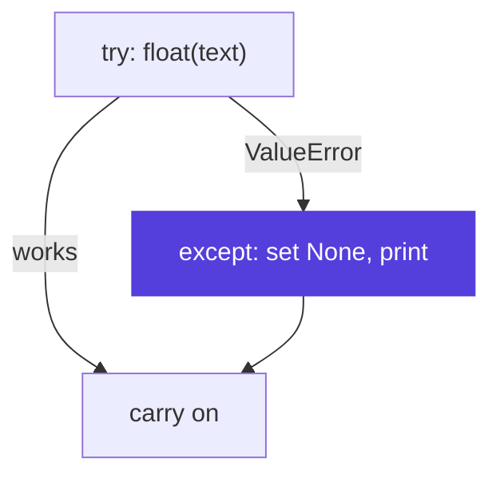

# <span class="dm-accent">Exceptions</span>

<!--
Things will go wrong in scripts that automate work, for example one bad row in a long log. This block shows how to handle an error you expect. You read your first tracebacks this morning.
-->

---
layout: default
label: 5 · Exceptions
---

# <span class="dm-accent">try / except</span> handles an error you expect

<div class="split">
<div>

```python {all|2-3|4-6|all}
text = "seven"
try:
    pressure_bar = float(text)
except ValueError:
    pressure_bar = None
    print(f"Skipping bad value: {text!r}")
print(pressure_bar)
```

<v-click>

```text
Skipping bad value: 'seven'
None
```

</v-click>
</div>

<div v-click>



</div>

</div>

<p class="note"><code>float("seven")</code> <b>raises</b> a <code>ValueError</code>. <code>except</code> <b>catches</b> it.</p>

<p class="ask" v-click><b>Question</b>What changes if you write <code>except:</code> without <code>ValueError</code>?</p>

<style>
.slidev-code { font-size: 17px !important; line-height: 1.5 !important; }
</style>

<!--
This morning you read a traceback for the ValueError from float("seven"). Sometimes an error is expected, for example one bad row in a long log. try runs the risky code, and if the named exception occurs, the except block runs instead of crashing the script. The script then carries on. The vocabulary: the code raises an exception, and you catch it. Your own code can raise one too, with the raise keyword, when it receives something it cannot handle. Execution continues after the whole block either way. Question on the slide: it then catches every error, also a typo in your own code and Ctrl+C. The script keeps running and hides the real problem. Name the error you expect.
-->

---
layout: default
label: 5 · Exceptions
---

# No plan for an error? <span class="dm-accent">Let it bubble up</span>

<DmColumns class="mt-2">
<DmColumn header="Swallowed" tone="plain">

```python
try:
    mean_bar = summarise(path)
except Exception:
    pass
```

The script carries on. The report is wrong or empty, and nothing tells you why.

</DmColumn>
<DmColumn header="Bubbles up" tone="violet" divider>

```python
mean_bar = summarise(path)
```

The error travels up through every function that called this one. Nobody catches it, so the script stops with a traceback: file, line and reason.

</DmColumn>
</DmColumns>

<v-clicks>

- Catch an error only where you can do something with it: skip the row and count it, use a default, ask again
- Need to add context? Catch it, then `raise` again with a better message
- A script that stops with a traceback is better than a script that finishes with a wrong number

</v-clicks>

<style>
.slidev-code { font-size: 16px !important; line-height: 1.45 !important; }
</style>

<!--
The second half of exception handling is knowing when not to catch. An exception that nobody catches does not disappear. It leaves the function where it happened, then the function that called it, and so on upward. That is what bubbling up, or propagating, means, and the list of functions in a traceback is exactly that path. If nothing catches it, Python stops the script and prints the traceback. That is not a failure of your script. It is the script telling you precisely what went wrong and where. The left column is the pattern to avoid: catch everything and do nothing. The script looks healthy, the summary file is written, and the numbers in it are wrong. Copilot writes this pattern often, because it makes the error go away. So the rule: catch an error only at the place where you have a plan for it. Skipping a bad row and counting it is a plan. Printing nothing and moving on is not. When the low-level message is not enough, catch the error, and raise it again with the file name and line number added, which is the last task in the exercise. For a script that runs every night, a loud stop is the safe default.
-->

---
layout: statement
---

# Exercise 07: <span class="dm-accent">Files and exceptions</span>

`exercises/python/07-files-and-exceptions`

<p class="words"><b>Words you can now use</b> exception · raise · catch · bubble up</p>

<style>
.words { font-size: 15px; opacity: 0.9; margin-top: 14px; }
.words b { margin-right: 8px; }
</style>

<!--
Fix one broken script by reading its traceback, starting at the bottom line. Then skip and count bad rows. The last task makes people decide where to catch: stop or skip.
-->
