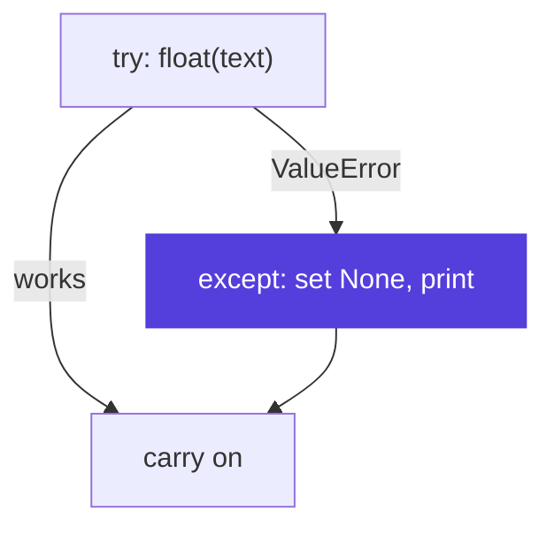

# <span class="dm-accent">Exceptions</span>

<!--
Things will go wrong in scripts that automate work, for example one bad row in a long log. This block shows how to handle an error you expect. You read your first tracebacks this morning.
-->

---
layout: default
label: 5 · Exceptions
---

# <span class="dm-accent">try / except</span> handles an error you expect

<div class="split">
<div>

```python {all|2-3|4-6|all}
text = "seven"
try:
    pressure_bar = float(text)
except ValueError:
    pressure_bar = None
    print(f"Skipping bad value: {text!r}")
print(pressure_bar)
```

<v-click>

```text
Skipping bad value: 'seven'
None
```

</v-click>
</div>

<div v-click>



</div>

</div>

<style>
.slidev-code { font-size: 17px !important; line-height: 1.5 !important; }
</style>

<!--
This morning you read a traceback for the ValueError from float("seven"). Sometimes an error is expected, for example one bad row in a long log. try runs the risky code, and if the named exception occurs, the except block runs instead of crashing the script. The script then carries on. The vocabulary: the code raises an exception, and you catch it. Your own code can raise one too, with the raise keyword, when it receives something it cannot handle. Execution continues after the whole block either way.
-->

---
layout: statement
---

# Exercise 07: <span class="dm-accent">Files and exceptions</span>

`exercises/python/07-files-and-exceptions`

<p class="words"><b>Words you can now use</b> exception · raise · catch</p>

<style>
.words { font-size: 15px; opacity: 0.9; margin-top: 14px; }
.words b { margin-right: 8px; }
</style>

<!--
Read and write files, handle a bad row, and then fix several broken scripts by reading their tracebacks. Start each time at the bottom line. About 30 minutes.
-->
