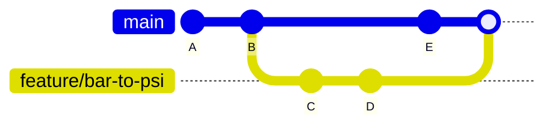
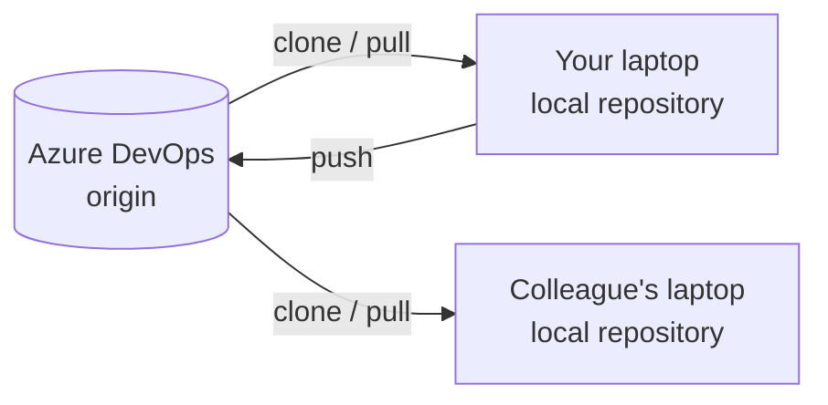
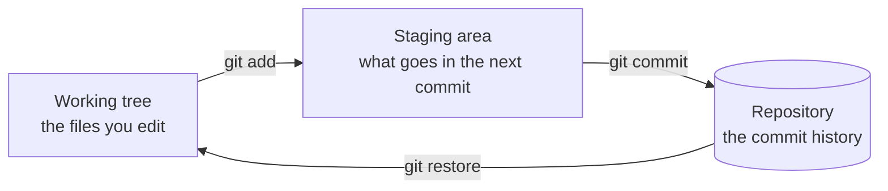

# Version <span class="dm-accent">control</span>

---
layout: default
label: 7 · Version control
---

# The <span class="dm-accent">final_v3</span> problem

```text
\\fileserver\compressors\testbench\
    analyse_run.py
    analyse_run_final.py
    analyse_run_final_v3_USE_THIS_ONE.py
```

<v-clicks>

- **History**: which version produced last week's report?
- **Who and why**: who changed the conversion factor?
- **Undo**: how do I get back to the version that worked?
- **Collaborate**: two people edit at once, whose version wins?

</v-clicks>

<style>
.slidev-code { font-size: 16px !important; line-height: 1.5 !important; }
</style>

<!--
Ask who recognises this. Almost everyone does, from Excel files or MATLAB scripts on a network drive. The file names are an attempt at version control by hand. Version control gives you four things: a history, a record of who changed what and why, the ability to undo, and a way to work in parallel and combine the results. Git does all four, for any text file, and Python scripts are text files.
-->

---
layout: default
label: 7 · Version control
---

# Repository, commit, <span class="dm-accent">branch</span>

<DmColumns class="mt-2">
<DmColumn>

- **Repository**: a project folder plus its full history
- **Commit**: a saved snapshot with a message, author and date
- **Branch**: a movable label on a commit
- Work on a branch does not touch `main` until you merge it

</DmColumn>
<DmColumn divider>



</DmColumn>
</DmColumns>

<!--
A repository is your project folder with a hidden .git folder that holds the history. A commit is a snapshot of the files at a moment, with a message that says why; each commit points to the one before it. A branch is just a name pointing at a commit, and branches are cheap. You create one for each small piece of work and merge it back when it is ready. We do the merge later this afternoon.
-->

---
layout: default
label: 7 · Version control
---

# Git, Azure DevOps and the <span class="dm-accent">remote</span>



- **Git** is the free tool on your laptop, **Azure DevOps** hosts the shared copy
- A **remote** is that shared copy, by convention called `origin`

<!--
Keep these two apart in your head, because people mix them up. Git is the program, and every laptop holds the full history. Azure DevOps is a website that hosts a shared copy and adds sign-in, review and pipelines. GitHub and GitLab are alternatives; the Git commands are identical. Push sends your commits up, pull brings others' commits down, clone makes the first copy.
-->

---
layout: default
label: 7 · Version control
---

# Three areas on your <span class="dm-accent">laptop</span>



- You choose what goes into a commit by **staging** it first
- `git status` tells you which area each change is in

<!--
This picture is the most useful mental model of the day. You edit in the working tree. You pick the changes that belong together and stage them. Commit then stores what is staged. The staging area lets you make two commits out of one editing session. Come back to this slide whenever status output confuses someone.
-->
