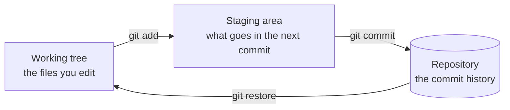
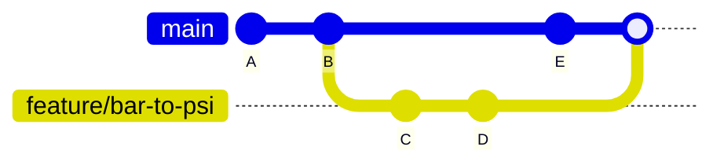
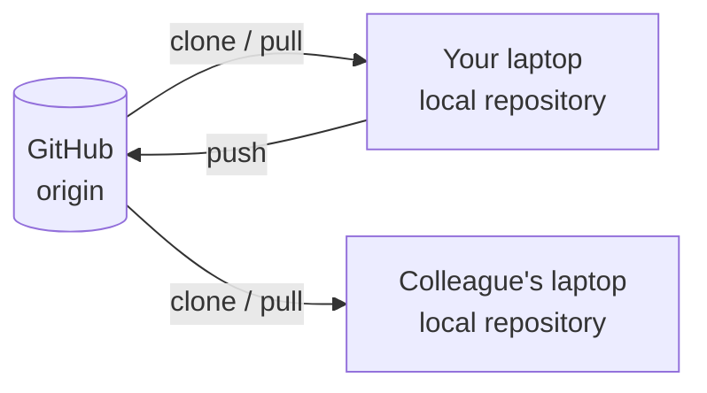

# Version <span class="dm-accent">control</span>

---
layout: default
label: 7 · Version control
---

# This prompt will <span class="dm-accent">make sense</span> by 17:00

<p class="prompt">Fetch and rebase `feature/max-temperature` onto `origin/main`. If a commit conflicts, stop and show me both sides. Then stage only `analyse_run.py` and commit it as a conventional commit, type `fix`, scope `analysis`. Do not commit `output/`. Push with `--force-with-lease` and draft the pull request description from `git diff origin/main`.</p>

<style>
.prompt { font-family: monospace; font-size: 18px; line-height: 1.6; background: var(--dm-surface); border-left: 4px solid var(--dm-connecting); border-radius: 8px; padding: 18px 22px; margin-top: 16px; }
</style>

<!--
This is what a specialist asks an assistant for. Every term in it is covered this afternoon: fetch, rebase, origin/main, a conflict and its two sides, staging, conventional commits with a type and a scope, keeping output out of Git, push with force-with-lease, pull request, and a diff against origin/main. Do not explain anything now. The same slide comes back in the wrap-up.
-->

---
layout: default
label: 7 · Version control
---

# <span class="dm-accent">final_v3</span> is version control by hand

<div class="split">
<div>

```text
\\fileserver\compressors\testbench\
    analyse_run.py
    analyse_run_final.py
    analyse_run_final_v3_USE_THIS_ONE.py
```

<p class="note">Git answers these four questions without copies of the file.</p>

</div>

<div class="grid-2">
<v-clicks>
<DmInfoCard icon="i-mdi-history" title="History">

Which version made last week's report?

</DmInfoCard>
<DmInfoCard icon="i-mdi-account-question-outline" title="Who and why">

Who changed the conversion factor?

</DmInfoCard>
<DmInfoCard icon="i-mdi-undo-variant" title="Undo">

How do I get back to what worked?

</DmInfoCard>
<DmInfoCard icon="i-mdi-account-multiple-outline" icon-tone="navy" title="Collaborate">

Two people edit, whose version wins?

</DmInfoCard>
</v-clicks>
</div>
</div>


<style>
.slidev-code { font-size: 16px !important; line-height: 1.5 !important; }
</style>

<!--
Ask who recognises this. Almost everyone does, from Excel files or MATLAB scripts on a network drive. The file names are an attempt at version control by hand. Version control gives you four things: a history, a record of who changed what and why, the ability to undo, and a way to work in parallel and combine the results. Git does all four, for any text file, and Python scripts are text files. This matters more with Copilot, not less: when an assistant writes or changes code, Git is how you see exactly what it changed, keep the good part and undo the rest, so small commits and a reviewed pull request become more important.
-->

---
layout: default
label: 7 · Version control
---

# Stage a hold, then <span class="dm-accent">hammer in an anchor</span>

<div class="climb">
<svg viewBox="0 0 430 380" class="wall" role="img" aria-label="A climber on a rock face with cracks and ledges. Three anchors below the climber are joined by a rope. The climber reaches for a marked hold. A dashed arrow shows that a fall stops at the last anchor.">
<defs><clipPath id="wallclip"><rect x="4" y="4" width="422" height="372" rx="14" /></clipPath></defs>
<g clip-path="url(#wallclip)">
<rect x="4" y="4" width="422" height="372" fill="#eef3fb" />
<path d="M4 376 L4 58 L38 30 L78 44 L112 18 L150 34 L186 12 L236 30 L270 14 L312 40 L348 22 L388 48 L426 36 L426 376 Z" fill="#dedbef" />
<path d="M4 58 L38 30 L78 44 L70 130 L96 240 L60 352 L4 352 Z" fill="#cfcbe6" />
<path d="M312 40 L348 22 L388 48 L426 36 L426 352 L340 352 L310 270 L352 170 L322 90 Z" fill="#d3cfe9" />
<path d="M112 18 L150 34 L140 80 L118 60 Z M236 30 L270 14 L282 70 L250 62 Z" fill="#ebe9f6" />
<g fill="none" stroke="#b3aed6" stroke-width="1.6" stroke-linejoin="round" stroke-linecap="round">
<path d="M78 44 L70 130 L96 240 L60 352" /><path d="M322 90 L352 170 L310 270 L340 352" />
<path d="M150 34 L140 80 L156 128 L146 170" /><path d="M270 14 L282 70 L268 112 L290 150" />
<path d="M96 240 L128 262 L120 300" /><path d="M310 270 L276 288 L284 326" /><path d="M352 170 L384 190 L378 232" />
<path d="M20 150 L48 162 L40 200" /><path d="M396 96 L372 118" />
</g>
<g stroke="#a59fce" stroke-width="3" stroke-linecap="round">
<path d="M104 196 L150 192" /><path d="M232 214 L286 210" /><path d="M214 300 L262 296" /><path d="M24 262 L58 258" /><path d="M356 300 L404 296" />
</g>
<g fill="#a59fce">
<path d="M112 296 l14 -5 l6 7 l-12 6 z" /><path d="M228 322 l13 -6 l7 6 l-11 7 z" /><path d="M122 214 l13 -5 l6 7 l-12 5 z" />
<path d="M243 238 l13 -6 l6 7 l-12 6 z" /><path d="M118 122 l13 -6 l6 7 l-11 6 z" /><path d="M168 48 l13 -5 l6 7 l-12 5 z" />
<path d="M262 44 l13 -6 l6 7 l-11 6 z" /><path d="M208 154 l13 -5 l6 6 l-12 6 z" /><path d="M170 152 l13 -5 l6 7 l-12 5 z" />
</g>
<rect x="4" y="352" width="422" height="24" fill="#b9b4dc" />
<path d="M4 352 L426 352" stroke="#8f88c4" stroke-width="2" />
</g>
<polyline points="170,352 170,335 205,255 180,175 196,122" fill="none" stroke="var(--dm-premium)" stroke-width="2.5" stroke-linejoin="round" />
<g fill="var(--dm-connecting)" stroke="#fff" stroke-width="2.5">
<circle cx="170" cy="335" r="9" /><circle cx="205" cy="255" r="9" /><circle cx="180" cy="175" r="9" />
</g>
<g style="font-family: monospace; font-size: 12px;" fill="var(--dm-premium)">
<text x="188" y="339">a05588 Add conversion</text>
<text x="223" y="259">9b221a Add measurement</text>
<text x="36" y="179">c41d07 Fix factor</text>
</g>
<g stroke="var(--dm-premium)" stroke-width="4.5" stroke-linecap="round" fill="none">
<circle cx="200" cy="88" r="9" fill="var(--dm-premium)" stroke="none" />
<path d="M199 99 L196 126" /><path d="M199 104 L228 74" /><path d="M199 104 L178 112" />
<path d="M196 126 L215 149" /><path d="M196 126 L180 147" />
</g>
<circle cx="232" cy="70" r="10" fill="none" stroke="var(--dm-connecting)" stroke-width="3.5" />
<path d="M246 68 L282 68" stroke="var(--dm-connecting)" stroke-width="1.5" />
<text x="288" y="72" style="font-size: 14px; font-weight: 600;" fill="var(--dm-connecting)">staged hold</text>
<path d="M232 118 Q262 160 198 176" fill="none" stroke="var(--dm-connecting)" stroke-width="2" stroke-dasharray="6 5" />
<path d="M198 176 L210 168 M198 176 L211 181" fill="none" stroke="var(--dm-connecting)" stroke-width="2" stroke-linecap="round" />
<text x="262" y="150" style="font-size: 14px; font-weight: 600;" fill="var(--dm-connecting)">a fall stops here</text>
<text x="188" y="368" style="font-size: 13px;" fill="var(--dm-premium)">the ground: git init</text>
</svg>
<div class="map">
<v-clicks>
<div class="row"><b>Working tree</b><span>You try moves above the last anchor. Nothing is saved yet.</span></div>
<div class="row"><b>Stage <code>git add</code></b><span>You pick the holds for the next move.</span></div>
<div class="row"><b>Commit <code>git commit</code></b><span>You hammer in an anchor and clip the rope. A fall takes you back to it, not to the ground.</span></div>
<div class="row"><b>History</b><span>The line of anchors below you.</span></div>
</v-clicks>
</div>
</div>

<style>
.climb { display: grid; grid-template-columns: 430px 1fr; gap: 28px; align-items: center; margin-top: 4px; }
.wall { width: 430px; height: 380px; }
.wall text { font-size: 13px !important; line-height: 1 !important; }
.wall g text { font-size: 12px !important; }
.map { display: flex; flex-direction: column; gap: 12px; }
.row { display: flex; flex-direction: column; gap: 2px; padding: 10px 16px; border-left: 4px solid var(--dm-connecting); background: var(--dm-surface); border-radius: 8px; font-size: 17px; line-height: 1.4; }
.row b { color: var(--dm-premium); }
.row code { font-size: 14px; margin-left: 6px; }
</style>

<!--
One picture for the afternoon. A climber on a new route tries moves above the last anchor: that is your working tree, the files you are editing. Before moving up, the climber picks the holds to use: that is staging, you choose which changes belong in the next step. Then the climber hammers in an anchor and clips the rope: that is the commit. From then on a fall takes you back to that anchor, not to the ground. git restore is that fall, on purpose. The anchors below you are the history, and each has a message that says why it is there. Place anchors often: a long stretch without one means a long fall. The next slide gives the same three steps their Git names.
-->

---
layout: default
label: 7 · Version control
---

# A change moves through <span class="dm-accent">three areas</span>



- You choose what goes into a commit by **staging** it first (the staging area is also called the **index**)
- `git status` tells you which area each change is in


<!--
The same three steps as the climber, now with the Git names. This picture is the most useful mental model of the day. You edit in the working tree. You pick the changes that belong together and stage them. Commit then stores what is staged. The staging area lets you make two commits out of one editing session. Come back to this slide whenever status output confuses someone.
-->

---
layout: default
label: 7 · Version control
---

# A <span class="dm-accent">hash</span> is the name Git gives to content

<div class="chain">
<div class="obj"><span class="h">a05588…</span><span>files: snapshot <code>7c1e…</code></span><span>parent: none</span><span>Jan · 3 March · "Add conversion"</span></div>
<div class="arrow">←</div>
<div class="obj"><span class="h">9b221a…</span><span>files: snapshot <code>e02b…</code></span><span>parent: <code>a05588…</code></span><span>Sofie · 5 March · "Add measurement"</span></div>
<div class="arrow">←</div>
<div class="obj"><span class="h">c41d07…</span><span>files: snapshot <code>41fa…</code></span><span>parent: <code>9b221a…</code></span><span>Jan · 6 March · "Fix factor"</span></div>
</div>

<v-clicks>

- Git stores every file and every commit under the **hash of its content**: 40 characters, calculated with SHA-1
- Same content, same hash. Change one character and the hash changes
- A commit contains its parent's hash, so changing an old commit changes every hash after it
- The first 7 characters are enough to point at a commit: `git show c41d07a`

</v-clicks>

<style>
.chain { display: flex; align-items: center; gap: 10px; margin: 6px 0 14px; }
.obj { flex: 1; display: flex; flex-direction: column; gap: 3px; padding: 10px 14px; border-radius: 8px; background: var(--dm-surface); border-top: 4px solid var(--dm-connecting); font-size: 14px; color: var(--dm-premium); }
.obj .h { font-family: monospace; font-weight: 700; font-size: 16px; color: var(--dm-connecting); }
.obj code { font-size: 13px; }
.arrow { font-size: 22px; color: var(--dm-connecting); }
</style>

<!--
The climber's anchors need names, and Git does not number them. Git is a content-addressable store: you hand it content and it files that content under a hash of the content itself. That goes for every version of every file and for every commit. A commit is a small text record: which snapshot of the files, which parent commit, who, when and the message. The hash of that record is the name of the commit. Two consequences. First, identical content always gets the same hash, so Git stores a file that did not change only once. Second, each commit contains the hash of its parent, so nobody can change an old commit without every later hash changing too. That is why a hash is a safe way to say exactly which version made last week's report. You never type all 40 characters, the first 7 are enough.
-->

---
layout: default
label: 7 · Version control
---

# A <span class="dm-accent">branch</span> is a movable label on a commit

<DmColumns class="mt-2">
<DmColumn>

- **Repository**: a project folder plus its full history
- **Commit**: a saved snapshot with a message, author and date
- **Branch**: a movable label on a commit
- Work on a branch does not touch `main` until you merge it

</DmColumn>
<DmColumn divider>



</DmColumn>
</DmColumns>

<!--
A commit has a hash, and a branch is a label that holds one hash. A repository is your project folder with a hidden .git folder that holds the history. A commit is a snapshot of the files at a moment, with a message that says why; each commit points to the one before it. A branch is just a name pointing at a commit, and branches are cheap. In the climbing picture it is a second route that starts from an existing anchor. You create one for each small piece of work and merge it back when it is ready. We do the merge later this afternoon.
-->

---
layout: default
label: 7 · Version control
---

# GitHub hosts the shared <span class="dm-accent">remote</span>



- **Git** is the free tool on your laptop, **GitHub** hosts the shared copy
- A **remote** is that shared copy, by convention called `origin`

<p class="words"><b>Words you can now use</b> repository · commit · branch · remote · working tree · staging area</p>

<style>
.words { font-size: 15px; opacity: 0.9; margin-top: 14px; }
.words b { margin-right: 8px; }
</style>

<!--
Keep these two apart in your head, because people mix them up. Git is the program, and every laptop holds the full history. GitHub is a website that hosts a shared copy and adds sign-in, review and pipelines. Azure DevOps and GitLab are alternatives; the Git commands are identical. Atlas Copco uses Azure DevOps, which comes on day 3; only the web pages differ. Push sends your commits up, pull brings others' commits down, clone makes the first copy. The strip at the bottom lists the words they should now be able to use in a request to a colleague or to Copilot.
-->
