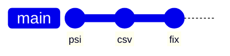
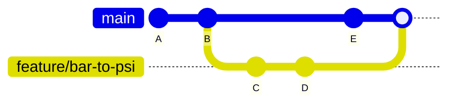
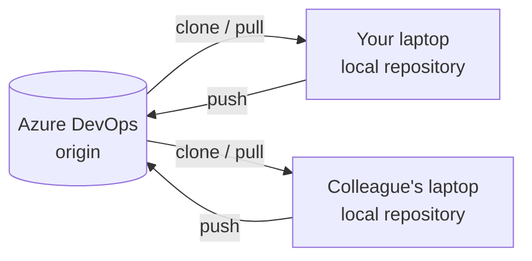
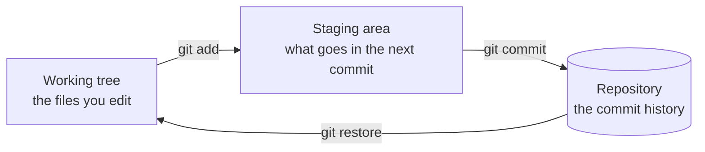

# Version <span class="dm-accent">control</span>

---
layout: default
label: 7 · Version control
---

# The <span class="dm-accent">final_v3</span> problem

```text
\\fileserver\compressors\testbench\
    analyse_run.py
    analyse_run_final.py
    analyse_run_final_v2.py
    analyse_run_final_v3_JK_edit.py
    analyse_run_final_v3_USE_THIS_ONE.py
```

<v-clicks>

- Which one produced last week's report?
- Who changed the conversion factor, and why?
- Two people edited at the same time: whose version wins?

</v-clicks>

<!--
Ask who recognises this. Almost everyone does, from Excel files or MATLAB scripts on a network drive. The file names are an attempt at version control by hand. It works until two people edit, or until you need to know what exactly changed between v2 and v3. That is the problem the afternoon solves.
-->

---
layout: default
label: 7 · Version control
---

# What we want from a <span class="dm-accent">version control</span> tool

<div class="badges">
  <DmIconBadge icon="i-mdi-history" label="History" sub="Every saved state, kept" />
  <DmIconBadge icon="i-mdi-comment-text-outline" label="Who and why" sub="Author, date and a message" />
  <DmIconBadge icon="i-mdi-undo-variant" label="Undo" sub="Go back to any earlier state" />
  <DmIconBadge icon="i-mdi-account-group-outline" label="Collaborate" sub="Work in parallel, then combine" />
</div>

<style>
.badges { display: grid; grid-template-columns: repeat(4, 1fr); gap: 16px; margin-top: 48px; }
</style>

<!--
Four things, in this order. History is the base. Who and why is what the file names never told you. Undo makes it safe to try things. Collaboration is what turns it into a team tool. Git gives all four, for any text file, and Python scripts are text files.
-->

---
layout: default
label: 7 · Version control
---

# <span class="dm-accent">Git</span> is the tool, <span class="dm-accent">Azure DevOps</span> is the host

<DmColumns class="mt-6">
<DmColumn header="Git" tone="navy">

- Free program on your laptop
- Keeps the history of a folder
- Works offline
- Same tool everywhere

</DmColumn>
<DmColumn header="Azure DevOps Repos" tone="violet" divider>

- Server that stores a shared copy
- Sign-in, permissions, backup
- Pull requests and review
- Pipelines, later in this training

</DmColumn>
</DmColumns>

<p class="mt-6 text-center">Comparable to MATLAB and a network drive, except Git tracks changes and the host adds teamwork.</p>

<!--
Keep these two apart in your head, because people mix them up. Git is the program. Azure DevOps is a website that hosts copies of your repositories and adds review and access control. GitHub and GitLab are alternatives to Azure DevOps; the Git commands you learn are identical for all of them.
-->

---
layout: default
label: 7 · Version control
---

# Repository and <span class="dm-accent">commit</span>

<DmColumns class="mt-2">
<DmColumn>

- **Repository**: a project folder plus its full history
- **Commit**: one saved snapshot of the project
- Each commit has a message, an author, a date and a parent
- Commits form a chain, newest at the end

</DmColumn>
<DmColumn divider>



</DmColumn>
</DmColumns>

<!--
A repository is simply your project folder with a hidden .git folder that holds the history. A commit is a snapshot of all tracked files at a moment, with a message that says why. Each commit points to the one before it, which is how Git can show you the history. You do not need to know more than that today.
-->

---
layout: default
label: 7 · Version control
---

# Branch: a <span class="dm-accent">movable label</span>

<DmColumns class="mt-2">
<DmColumn>

- A branch is a name that points at a commit
- New commits move the label forward
- Work on a branch does not touch `main`
- Merge it back when it is ready

</DmColumn>
<DmColumn divider>



</DmColumn>
</DmColumns>

<!--
Branches are cheap in Git, which is what makes the workflow work. You create one for each small piece of work, commit on it freely, and main stays stable until you decide to merge. Do not worry yet about how the merge works; that is later this afternoon.
-->

---
layout: default
label: 7 · Version control
---

# Remote: another copy, <span class="dm-accent">somewhere else</span>



- Every laptop holds the **full history**; the remote is the shared meeting point
- By convention the remote is called `origin`

<!--
Git is distributed: each laptop has a complete copy. The remote on Azure DevOps is the agreed meeting point where people exchange their work. Push sends your commits up, pull brings others' commits down, clone makes the first copy.
-->

---
layout: default
label: 7 · Version control
---

# Three areas on your <span class="dm-accent">laptop</span>



- You choose what goes into a commit by **staging** it first
- `git status` tells you which area each change is in

<!--
This picture is the most useful mental model of the day. You edit in the working tree. You pick the changes that belong together and stage them. Commit then stores what is staged. The staging area lets you make two commits out of one editing session. Come back to this slide whenever status output confuses someone.
-->

---
layout: default
label: 7 · Version control
---

# Vocabulary <span class="dm-accent">recap</span>

| Term | In one line |
| --- | --- |
| Repository | Project folder with its history |
| Commit | A saved snapshot with a message |
| Staging area | Changes selected for the next commit |
| Branch | A movable label on a commit |
| Remote | A copy of the repository on a server |
| Pull request | A request to merge a branch, with review |

<!--
Quick check for understanding before the commands start. Cover the right column and ask for the explanation, or the other way around. Pull request is new: it is an Azure DevOps feature, not a Git command, and we get to it later in this block.
-->
