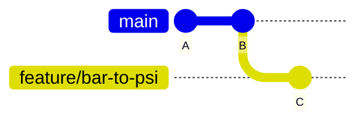

# Git on the <span class="dm-accent">command line</span>

---
layout: default
label: 8 · Git on the command line
---

# Tell Git <span class="dm-accent">who you are</span>

```powershell
git config --global user.name "Your Name"
git config --global user.email "you@atlascopco.com"
git config --global init.defaultBranch main
git config --global --list
```

- Do this once per laptop
- Use the same email as your Azure DevOps account
- The name and email end up in every commit you make

<!--
Git refuses to commit without an identity, and it stamps this on every commit. Use the work email that matches the Azure DevOps account so that commits are linked to the right person. The defaultBranch setting makes new repositories start with main. On managed laptops this may already be configured; the list command shows what is set.
-->

---
layout: default
label: 8 · Git on the command line
---

# Start a repository: <span class="dm-accent">init</span> and <span class="dm-accent">status</span>

```powershell
mkdir testbench
cd testbench
git init -b main
git status
```

```text
Initialized empty Git repository in C:/Users/you/testbench/.git/
On branch main

No commits yet

nothing to commit (create/copy files and use "git add" to track)
```

<!--
Make a folder, enter it, and turn it into a repository. From now on git status is the command you run all the time. It never changes anything, so use it freely. Show the hidden .git folder in Explorer once, then move on.
-->

---
layout: default
label: 8 · Git on the command line
---

# Stage and <span class="dm-accent">commit</span>

```powershell
git add conversions.py
git status
git commit -m "Add psi to bar conversion"
```

```text
Changes to be committed:
	new file:   conversions.py

[main (root-commit) a055887] Add psi to bar conversion
 1 file changed, 2 insertions(+)
 create mode 100644 conversions.py
```

- `git add .` stages everything in the folder; check `git status` first

<!--
Add moves a change into the staging area, commit stores it. The hash in brackets is the commit's ID; you rarely type it in full. Warn about git add dot: it stages everything, including files you did not mean to commit. Status before and after is a good habit.
-->

---
layout: default
label: 8 · Git on the command line
---

# A good <span class="dm-accent">commit message</span>

<DmColumns class="mt-4">
<DmColumn header="Avoid" tone="plain">

```text
update
```

```text
fixed stuff
```

```text
analyse_run final
```

</DmColumn>
<DmColumn header="Prefer" tone="navy" divider>

```text
Fix psi to bar factor
```

```text
Add run filter to analyse_run
```

```text
Read measurements as UTF-8
```

</DmColumn>
</DmColumns>

<p class="mt-4 text-center">Short, imperative, says what the commit does. One logical change per commit.</p>

<!--
The message is for your colleague, and for you in six months. Write it as a command: add, fix, remove, rename. Around 50 characters is enough for the subject line. If a commit needs the word and in its message, it is probably two commits.
-->

---
layout: default
label: 8 · Git on the command line
---

# Read the history with <span class="dm-accent">log</span>

```powershell
git log --oneline
```

```text
9b221ad Add first measurement
a055887 Add psi to bar conversion
```

```powershell
git log            # full format: author, date, message
git log --graph --oneline --all   # branches too
```

<!--
Oneline is the format you will use most. The long form shows the author and date. The graph option draws branches, which becomes useful in a few slides. Remind them that this opens a pager if the output is long; the pager tip is two slides on.
-->

---
layout: default
label: 8 · Git on the command line
---

# See what changed with <span class="dm-accent">diff</span>

```powershell
git diff            # working tree vs staging area
git diff --staged   # staging area vs last commit
```

```text
--- a/conversions.py
+++ b/conversions.py
@@ -1,2 +1,6 @@
 def psi_to_bar(psi):
     return psi * 0.0689476
+
+
+def bar_to_psi(bar):
+    return bar / 0.0689476
```

<!--
Lines with a plus are added, lines with a minus are removed, the rest is context. Run diff before you stage and again with staged before you commit: it is a free review of your own work. If diff prints nothing, either nothing changed or it is already staged.
-->

---
layout: default
label: 8 · Git on the command line
---

# Tip: <span class="dm-accent">q</span> leaves the pager

<DmColumns class="mt-4">
<DmColumn>

When output is long, Git shows it in a pager and the prompt seems stuck.

- `q` quits
- Space scrolls down, `b` scrolls up
- `/word` searches

</DmColumn>
<DmColumn divider>

<div class="pager">
<div>9b221ad Add first measurement</div>
<div>a055887 Add psi to bar conversion</div>
<div>...</div>
<div class="pager-end">(END)</div>
</div>

</DmColumn>
</DmColumns>

<style>
.pager { background: #111; color: #ddd; font-family: monospace; padding: 14px; border-radius: 6px; font-size: 14px; }
.pager-end { color: #fff; margin-top: 8px; }
</style>

<!--
This catches someone every single time. Git is not hanging, it is waiting for you in a pager. Press q. The same applies to git branch and git diff when the output exceeds the screen height.
-->

---
layout: statement
title: Exercise - first commit
---

# Exercise time: <span class="dm-accent">first commit</span>

<p class="mt-6 text-lg opacity-80"><code>exercises/git/01-first-commit</code></p>
<p class="mt-2 text-sm opacity-70"><code>uv run python exercises/git/setup_exercise.py 1</code></p>

<!--
Participants run the setup script, which creates a sandbox repository in their home folder. They practice init, status, add, commit, log and diff. Walk around, and watch for people who forgot the identity configuration. Allow about fifteen minutes.
-->

---
layout: default
label: 8 · Git on the command line
---

# Undo a change: <span class="dm-accent">restore</span>

```powershell
git restore conversions.py            # discard edits since last commit
git restore --staged conversions.py   # unstage, keep the edits
```

- `git restore <file>` throws your edits away: there is no undo for that
- Committed work is safe: you can always get it back

<!--
Two uses of restore. Without flags it resets the file to the last commit, and the uncommitted edits are gone, so be sure. With staged it only removes the file from the staging area and leaves your edits alone. This is the point where the safety of version control becomes tangible.
-->

---
layout: default
label: 8 · Git on the command line
---

# Look at an <span class="dm-accent">old version</span>

```powershell
git show a055887                       # one commit: message and diff
git show HEAD~1:conversions.py         # a file as it was one commit ago
git restore --source=HEAD~1 conversions.py
```

- `HEAD` is the latest commit, `HEAD~1` the one before it
- You can use the short ID from `git log --oneline` instead
- Restoring an old version shows up as a normal change: commit it or discard it

<!--
Show is read-only: it prints what was true then. The restore with a source brings that old content into your working tree, where you can inspect or commit it. HEAD is just the name for where you are now. We stay clear of detached HEAD and resetting history; for daily use this is enough.
-->

---
layout: statement
title: Exercise - history
---

# Exercise time: <span class="dm-accent">history</span>

<p class="mt-6 text-lg opacity-80"><code>exercises/git/02-history</code></p>
<p class="mt-2 text-sm opacity-70"><code>uv run python exercises/git/setup_exercise.py 2</code></p>

<!--
Participants explore a repository that already has several commits: log, show, diff, look at an old version and restore it. About ten minutes.
-->

---
layout: default
label: 8 · Git on the command line
---

# Branches: <span class="dm-accent">switch</span> and create

```powershell
git switch -c feature/bar-to-psi   # create and move to a new branch
git branch                         # list local branches
git switch main                    # go back
git branch -d feature/bar-to-psi   # delete after merging
```

```text
  feature/bar-to-psi
* main
```

- The `*` marks the branch you are on

<!--
Switch with dash c creates a branch and moves you onto it in one step. Your working tree changes to match the branch, which can surprise people: files appear and disappear. Commit or restore your changes before switching. Branch names with a slash such as feature/ are a common convention.
-->

---
layout: default
label: 8 · Git on the command line
---

# Merge: <span class="dm-accent">fast-forward</span>



```powershell
git switch main
git merge feature/bar-to-psi
```

```text
Updating 9b221ad..1cd9279
Fast-forward
```

<!--
If main has not moved since you branched, Git simply moves the main label forward to the end of your branch. No new commit is needed, the history stays a straight line. This is the simple case.
-->

---
layout: default
label: 8 · Git on the command line
---

# Merge: <span class="dm-accent">merge commit</span>

```powershell
git merge feature/rounding
git log --oneline --graph
```

```text
*   bc8a0a7 Merge branch 'feature/rounding'
|\
| * 3a2e549 Add analyse_run
* | 247671c Add readme.py
|/
* 1cd9279 Add bar to psi conversion
```

- Both branches moved, so Git creates a commit that joins them
- It may open an editor for the message: save and close it

<!--
When main also got commits while you worked, a straight line is impossible. Git creates a merge commit with two parents. Graph view shows the shape. If an editor opens for the merge message, accept the default, save and close; in VS Code, close the tab.
-->

---
layout: default
label: 8 · Git on the command line
---

# When two branches edit the <span class="dm-accent">same lines</span>

```powershell
git merge feature/a
```

```text
CONFLICT (content): Merge conflict in conversions.py
Automatic merge failed; fix conflicts and then commit the result.
```

```text
def psi_to_bar(psi):
<<<<<<< HEAD
    return psi * 0.068948
=======
    return psi * 0.06895
>>>>>>> feature/a
```

<!--
A conflict is not an error in Git, it is Git asking you to decide. Both branches changed the same line, and Git cannot know which is right. The file now contains markers: above the equals line is your current branch, below is the incoming branch. Nothing is lost.
-->

---
layout: default
label: 8 · Git on the command line
---

# Resolving a <span class="dm-accent">conflict</span>

<DmSteps dir="vertical">
<DmStep n="1" label="Open the file">VS Code highlights the conflict and offers Accept Current, Incoming or Both.</DmStep>
<DmStep n="2" label="Decide">Keep one side or combine them, and delete the three marker lines.</DmStep>
<DmStep n="3" label="Stage and commit"><code>git add conversions.py</code>, then <code>git commit</code>.</DmStep>
</DmSteps>

<p class="mt-4 text-center">Changed your mind? <code>git merge --abort</code> returns to before the merge.</p>

<!--
We only show the principle today. Conflicts are rare when branches are short-lived and people talk, which is one reason for the branching model we recommend later. The stretch part of the branches exercise lets them try one. If someone gets stuck, merge abort is the escape hatch.
-->

---
layout: statement
title: Exercise - branches
---

# Exercise time: <span class="dm-accent">branches</span>

<p class="mt-6 text-lg opacity-80"><code>exercises/git/03-branches</code></p>
<p class="mt-2 text-sm opacity-70"><code>uv run python exercises/git/setup_exercise.py 3</code></p>

<!--
Create a branch, commit on it, merge it into main and look at the graph. The stretch goal is to create and resolve a conflict. About fifteen minutes.
-->
