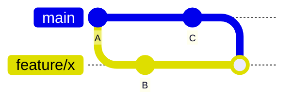
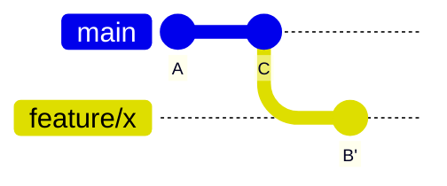

# Git on the <span class="dm-accent">command line</span>

---
layout: default
label: 8 · Git on the command line
---

# Use Git from the <span class="dm-accent">command line</span> or VS Code

<DmColumns class="mt-2">
<DmColumn header="VS Code" tone="navy">

Easier to use.

- Changed files, diffs and conflicts side by side
- Stage, commit and push with a click
- Next to the code you are editing

</DmColumn>
<DmColumn header="Command line" tone="violet" divider>

A skill that carries over.

- Works the same on a server, in a pipeline, on any laptop
- Every feature, and every error message and tutorial uses it
- Shows what Git does, step by step

</DmColumn>
</DmColumns>

<p class="note">An agent drives Git through commands. You can only judge what it did, or is about to do, if you can read them. So today: the command line first.</p>

<!--
Both drive the same Git on the same repository, so you can switch between them at any moment. The Source Control view in VS Code is the better experience for daily work: you see what changed, you click to stage, and the conflict view is good. The command line is the skill that transfers: it is the same on a build server, over a remote connection, in a pipeline and in every tutorial. There is a third reason, and it matters more each month. Coding agents work through the command line. When an agent proposes git reset, git push with force, or a rebase, you approve or refuse it, and you can only do that if you know what the command does. So we learn the commands today, by typing them. At the end of the afternoon there is a short demo of the same cycle in VS Code, and many of you will use that from tomorrow.
-->

---
layout: default
label: 8 · Git on the command line
---

# Set your identity once, then <span class="dm-accent">init a repository</span>

```powershell
git config --global user.name "Your Name"
git config --global user.email "you@atlascopco.com"
mkdir testbench
cd testbench
git init -b main
git status
```

- Identity: once per laptop, same email as your account on the forge
- `git status` never changes anything: run it all the time

<p class="note">A new file is <b>untracked</b>: Git sees it, but does not follow it until you <code>git add</code> it.</p>

<style>
.slidev-code { font-size: 16px !important; line-height: 1.5 !important; }
</style>

<!--
Git refuses to commit without an identity, and it stamps name and email on every commit. Use the work email that matches your account on the forge. Then make a folder and turn it into a repository with init. From now on git status is the command you run all the time, because it tells you where every change is.
-->

---
layout: default
label: 8 · Git on the command line
---

# <span class="dm-accent">Stage</span> what belongs together, then commit

```powershell
git add conversions.py
git commit -m "feat(conversions): add psi to bar conversion"
```

<p class="cc"><code>type(scope): description</code> is a <b>conventional commit</b>. The scope is optional.</p>

| Type | Use it for | Example |
|---|---|---|
| `feat` | new behaviour | `feat: report max temperature` |
| `fix` | a bug fix | `fix(conversions): correct psi to bar factor` |
| `docs` `test` `refactor` `chore` | no change in behaviour | `docs: explain the csv columns` |

- Description: short, imperative, one logical change. "and" in it means two commits
- `git add .` stages everything: check `git status` first

<style>
.slidev-code { font-size: 15px !important; line-height: 1.5 !important; }
.cc { font-size: 16px; margin: 6px 0 2px; }
table { font-size: 14px; }
td, th { padding: 4px 10px !important; }
li { font-size: 16px; }
</style>

<!--
Add moves a change into the staging area, commit stores it. The message is for your colleague and for you in six months. Conventional commits is a widely used format for it: a type, an optional scope in brackets, a colon, and a short description written as a command. The type says what kind of change it is, so a reader, a changelog tool or an assistant can sort the history without opening each commit. feat and fix are the two that matter most. A change that breaks existing use gets an exclamation mark after the type. Your team may use another convention, and then that one wins: the habit is a fixed format and one logical change per commit. If a description needs the word and, it is probably two commits. Warn about git add dot, which stages everything, including files you did not mean to commit. The exercises use plain messages such as Add conversions script, so nobody has to learn the format while learning to commit.
-->

---
layout: default
label: 8 · Git on the command line
---

# <span class="dm-accent">log</span> and <span class="dm-accent">diff</span> show what changed

```powershell
git log --oneline
git log --oneline --graph --all
```

```text
9b221ad chore(data): add first measurement
a055887 feat(conversions): add psi to bar conversion
```

```powershell
git diff            # edits not yet staged
git diff --staged   # what the next commit will contain
```

- `--graph --all` draws every branch as lines: you will read it in the branches exercise
- If the output is long, Git opens a pager: **q** leaves it

<style>
.slidev-code { font-size: 16px !important; line-height: 1.5 !important; }
</style>

<!--
Oneline is the format you will use most; git log --graph --oneline --all draws branches. Diff shows lines added with a plus and removed with a minus. Running diff before you commit is a free review of your own work. The pager tip catches someone every time: Git is not hanging, it is waiting for you. Press q.
-->

---
layout: statement
title: Exercise - first commit
---

# Exercise time: <span class="dm-accent">first commit</span>

<p class="mt-6 text-lg opacity-80"><code>exercises/git/01-first-commit</code></p>
<p class="mt-2 text-sm opacity-70">About 20 minutes: <code>uv run python exercises/git/setup_exercise.py 1</code></p>

<!--
Participants run the setup script, which creates a sandbox folder in their home folder. The tasks state a result and the commands are in HINTS.md: ask people to try for two minutes before opening it. They init, make commits that each say one thing, and predict what status shows for a file that is staged and then edited again. Walk around and watch for people who forgot the identity configuration.
-->

---
layout: default
label: 8 · Git on the command line
---

# <span class="dm-accent">show</span> and <span class="dm-accent">restore</span> bring back old versions

```powershell
git show a055887                     # one commit: message and diff
git show HEAD~1:conversions.py       # a file as it was one commit ago
git restore --source=HEAD~1 conversions.py
git restore conversions.py           # discard edits since last commit
```

- `HEAD` is the latest commit, `HEAD~1` the one before it
- `git restore <file>` throws your edits away: there is no undo for that

<style>
.slidev-code { font-size: 16px !important; line-height: 1.5 !important; }
</style>

<!--
Show is read-only: it prints what was true then. Restore with a source brings old content into your working tree, where you can inspect or commit it. Without a source it resets the file to the last commit, and the uncommitted edits are gone, so be sure. Committed work is always safe; that is the point of version control.
-->

---
layout: statement
title: Exercise - history
---

# Extra exercise: <span class="dm-accent">history</span>

<p class="mt-6 text-lg opacity-80"><code>exercises/git/02-history</code></p>
<p class="mt-2 text-sm opacity-70">When you are ahead, or after class: <code>uv run python exercises/git/setup_exercise.py 2</code></p>

<!--
Not done in class. It explores a repository that already has several commits: log, show, diff, look at an old version and restore it. Point early finishers here and move on to branches.
-->

---
layout: default
label: 8 · Git on the command line
---

# Work on a branch, then <span class="dm-accent">merge</span> it into main

<div class="bm">
<div>

```powershell
git switch -c feature/bar-to-psi
git add conversions.py
git commit -m "Add bar to psi conversion"
git switch main
git merge feature/bar-to-psi
```

```text
Updating 9b221ad..1cd9279
Fast-forward
```

- `git branch` lists branches
- `git branch -d <name>` deletes one

</div>
<svg viewBox="0 0 400 300" class="graph" role="img" aria-label="Two small commit graphs. In a fast-forward the main label moves forward to the commit of the feature branch. In a merge commit, main and the feature branch both have a new commit and a new commit M joins them.">
<text x="0" y="16" fill="var(--dm-premium)" style="font-size: 14px; font-weight: 600;">Fast-forward: main did not move</text>
<path d="M40 80 L240 80" stroke="var(--dm-premium)" stroke-width="3" />
<circle cx="40" cy="80" r="13" fill="var(--dm-premium)" /><text x="40" y="84" text-anchor="middle" fill="#fff" style="font-size: 12px; font-weight: 600;">A</text><circle cx="140" cy="80" r="13" fill="var(--dm-premium)" /><text x="140" y="84" text-anchor="middle" fill="#fff" style="font-size: 12px; font-weight: 600;">B</text><circle cx="240" cy="80" r="13" fill="var(--dm-connecting)" /><text x="240" y="84" text-anchor="middle" fill="#fff" style="font-size: 12px; font-weight: 600;">C</text>
<rect x="113" y="37" width="54" height="22" rx="5" fill="none" stroke="var(--dm-premium)" stroke-width="1.5" stroke-dasharray="4 3" /><text x="140" y="52" text-anchor="middle" fill="var(--dm-premium)" style="font-size: 12px;">main</text>
<path d="M170 48 L206 48" stroke="var(--dm-premium)" stroke-width="1.5" stroke-dasharray="4 3" /><path d="M206 48 l-7 -4 M206 48 l-7 4" stroke="var(--dm-premium)" stroke-width="1.5" fill="none" />
<rect x="213.0" y="37" width="54" height="22" rx="5" fill="var(--dm-premium)" /><text x="240" y="52" text-anchor="middle" fill="#fff" style="font-size: 12px; font-weight: 600;">main</text><rect x="207.0" y="101" width="66" height="22" rx="5" fill="var(--dm-connecting)" /><text x="240" y="116" text-anchor="middle" fill="#fff" style="font-size: 12px; font-weight: 600;">feature</text>
<text x="290" y="84" fill="var(--dm-premium)" style="font-size: 12px;">the label moves,</text><text x="290" y="100" fill="var(--dm-premium)" style="font-size: 12px;">no new commit</text>
<path d="M0 142 L400 142" stroke="#d8d5ee" stroke-width="1" />
<text x="0" y="170" fill="var(--dm-premium)" style="font-size: 14px; font-weight: 600;">Merge commit: main moved too</text>
<path d="M40 215 L340 215" stroke="var(--dm-premium)" stroke-width="3" />
<path d="M140 215 C170 215 170 270 200 270 L250 270 C300 270 300 215 340 215" fill="none" stroke="var(--dm-connecting)" stroke-width="3" />
<circle cx="40" cy="215" r="13" fill="var(--dm-premium)" /><text x="40" y="219" text-anchor="middle" fill="#fff" style="font-size: 12px; font-weight: 600;">A</text><circle cx="140" cy="215" r="13" fill="var(--dm-premium)" /><text x="140" y="219" text-anchor="middle" fill="#fff" style="font-size: 12px; font-weight: 600;">B</text><circle cx="240" cy="215" r="13" fill="var(--dm-premium)" /><text x="240" y="219" text-anchor="middle" fill="#fff" style="font-size: 12px; font-weight: 600;">D</text><circle cx="225" cy="270" r="13" fill="var(--dm-connecting)" /><text x="225" y="274" text-anchor="middle" fill="#fff" style="font-size: 12px; font-weight: 600;">C</text><circle cx="340" cy="215" r="13" fill="var(--dm-premium)" /><text x="340" y="219" text-anchor="middle" fill="#fff" style="font-size: 12px; font-weight: 600;">M</text>
<rect x="313.0" y="172" width="54" height="22" rx="5" fill="var(--dm-premium)" /><text x="340" y="187" text-anchor="middle" fill="#fff" style="font-size: 12px; font-weight: 600;">main</text><rect x="97.0" y="259" width="66" height="22" rx="5" fill="var(--dm-connecting)" /><text x="130" y="274" text-anchor="middle" fill="#fff" style="font-size: 12px; font-weight: 600;">feature</text>
<text x="398" y="294" text-anchor="end" fill="var(--dm-premium)" style="font-size: 12px;">M has two parents: D and C</text>
</svg>
</div>

<style>
.slidev-code { font-size: 14px !important; line-height: 1.5 !important; }
.bm { display: grid; grid-template-columns: 1fr 400px; gap: 28px; align-items: start; margin-top: 4px; }
.bm > * { min-width: 0; }
.graph { width: 400px; height: 300px; }
.graph text { line-height: 1 !important; }
li { font-size: 16px; }
</style>

<!--
Switch with dash c creates a branch and moves you onto it. Your working tree changes to match the branch, so commit or restore before switching. If main has not moved since you branched, Git just moves the label forward: a fast-forward. If main also got commits, Git creates a merge commit with two parents and may open an editor for the message; accept the default, save and close.
-->

---
layout: default
label: 8 · Git on the command line
---

# A <span class="dm-accent">conflict</span> means Git needs you to decide

<div class="cf">
<svg viewBox="0 0 330 250" class="graph2" role="img" aria-label="A commit graph. After commit B, main and feature/a each have a commit that changes the same line with a different factor. The merge is marked with a question mark.">
<path d="M30 70 L300 70" stroke="var(--dm-premium)" stroke-width="3" />
<path d="M110 70 C140 70 140 170 170 170 L200 170 C250 170 250 70 300 70" fill="none" stroke="var(--dm-connecting)" stroke-width="3" />
<circle cx="30" cy="70" r="13" fill="var(--dm-premium)" /><text x="30" y="74" text-anchor="middle" fill="#fff" style="font-size: 12px; font-weight: 600;">A</text><circle cx="110" cy="70" r="13" fill="var(--dm-premium)" /><text x="110" y="74" text-anchor="middle" fill="#fff" style="font-size: 12px; font-weight: 600;">B</text><circle cx="200" cy="70" r="13" fill="var(--dm-premium)" /><text x="200" y="74" text-anchor="middle" fill="#fff" style="font-size: 12px; font-weight: 600;">D</text><circle cx="185" cy="170" r="13" fill="var(--dm-connecting)" /><text x="185" y="174" text-anchor="middle" fill="#fff" style="font-size: 12px; font-weight: 600;">C</text>
<circle cx="300" cy="70" r="15" fill="#fff" stroke="#d1344b" stroke-width="3" /><text x="300" y="76" text-anchor="middle" fill="#d1344b" style="font-size: 17px; font-weight: 700;">?</text>
<rect x="152.0" y="11" width="96" height="22" rx="5" fill="var(--dm-premium)" /><text x="200" y="26" text-anchor="middle" fill="#fff" style="font-size: 12px; font-weight: 600;">main (HEAD)</text><rect x="62.0" y="159" width="76" height="22" rx="5" fill="var(--dm-connecting)" /><text x="100" y="174" text-anchor="middle" fill="#fff" style="font-size: 12px; font-weight: 600;">feature/a</text>
<text x="200" y="46" text-anchor="middle" fill="var(--dm-premium)" style="font-family: monospace; font-size: 12px;">psi * 0.068948</text>
<text x="185" y="204" text-anchor="middle" fill="var(--dm-connecting)" style="font-family: monospace; font-size: 12px;">psi * 0.06895</text>
<text x="165" y="238" text-anchor="middle" fill="var(--dm-premium)" style="font-size: 13px;">Both changed the same line after B.</text>
</svg>
<div>

```text
CONFLICT (content): Merge conflict in conversions.py

def psi_to_bar(psi):
<<<<<<< HEAD
    return psi * 0.068948
=======
    return psi * 0.06895
>>>>>>> feature/a
```

<p class="sides"><b>Above</b> <code>=======</code> is your branch. <b>Below</b> is the incoming branch.</p>

</div>
</div>

- Nothing is lost. Edit the file, delete the marker lines, then `git add` and `git commit`
- Changed your mind? `git merge --abort`
- **Tip:** agents are excellent at solving merge conflicts. Read the result with `git diff` before you commit

<p class="ask" v-click><b>Question</b>Two people change different lines of the same file. Is that a conflict?</p>

<style>
.slidev-code { font-size: 14px !important; line-height: 1.45 !important; }
.cf { display: grid; grid-template-columns: 290px 1fr; gap: 24px; align-items: center; margin-top: 2px; }
.cf > * { min-width: 0; }
.graph2 { width: 290px; height: 220px; }
.graph2 text { line-height: 1 !important; }
.sides { font-size: 15px; margin: 4px 0 0; }
li { font-size: 16px; }
</style>

<!--
Both branches changed the same line, and Git cannot know which is right. The file now contains markers: above the equals line is your current branch, below is the incoming branch. VS Code highlights this and offers Accept Current, Incoming or Both. We only show the principle; conflicts are rare when branches are short-lived and people talk. The branches exercise lets everyone create and resolve one. The tip: resolving a conflict is mostly reading two versions and combining them, which an agent does well, and it can explain both sides to you first. You still decide which factor is right, so read the diff before you commit. Question on the slide: no. Git merges line by line and combines both changes without asking. A conflict only happens when both changed the same lines.
-->

---
layout: default
label: 8 · Git on the command line
---

# <span class="dm-accent">Rebase</span> replays your commits on top of main

<DmColumns class="mt-2">
<DmColumn header="git merge main" tone="navy">



Keeps both lines, adds a merge commit.

</DmColumn>
<DmColumn header="git rebase main" tone="violet" divider>



Replays your commits after the latest `main`: a straight line, new hashes.

</DmColumn>
</DmColumns>

```powershell
git switch feature/x; git rebase main
git add <file>; git rebase --continue   # after fixing a conflict
git rebase --abort                      # give up
```

<p class="note">Rebase before you push. Rebasing rewrites commits, so a branch you already pushed needs <code>git push --force-with-lease</code> afterwards, and colleagues who pulled the old commits get duplicates.</p>

<style>
.slidev-code { font-size: 14px !important; line-height: 1.4 !important; }
</style>

<!--
The situation: you branched from main, and main got new commits since. There are two ways to catch up. Merge records what happened. Rebase tidies the branch before you share it. After a rebase, merging the branch into main is a fast-forward. The commits get new hashes because their parent changed. If the branch was already pushed, a rebase needs git push with force-with-lease, which is why the rule is to rebase before the first push. A squash merge in a pull request gives a similarly clean main without anyone rebasing. The last task of the branches exercise is a rebase with a conflict.
-->

---
layout: statement
title: Exercise - branches
---

# Exercise time: <span class="dm-accent">branches</span>

<p class="mt-6 text-lg opacity-80"><code>exercises/git/03-branches</code></p>
<p class="mt-2 text-sm opacity-70">About 20 minutes: <code>uv run python exercises/git/setup_exercise.py 3</code></p>

<p class="words"><b>Words you can now use</b> stage · commit message · diff · HEAD · merge · fast-forward · conflict · rebase</p>

<style>
.words { font-size: 15px; opacity: 0.9; margin-top: 40px; }
.words b { margin-right: 8px; }
</style>

<!--
Create a branch, commit on it, merge it into main and look at the graph. They then merge `experiment/psi-precision` into main, which conflicts, and resolve it: the conflict is a core part, about 20 minutes in total. The words at the bottom are the ones they can now use when asking a colleague or Copilot for help, or when reviewing.
-->
