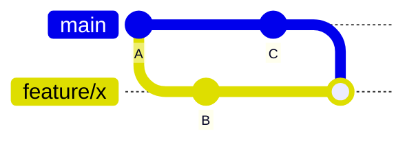
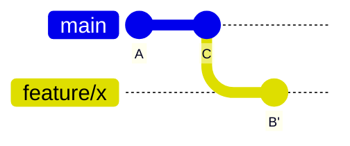

# Git on the <span class="dm-accent">command line</span>

---
layout: default
label: 8 · Git on the command line
---

# Set your identity once, then <span class="dm-accent">init a repository</span>

```powershell
git config --global user.name "Your Name"
git config --global user.email "you@atlascopco.com"
mkdir testbench
cd testbench
git init -b main
git status
```

- Identity: once per laptop, same email as your Azure DevOps account
- `git status` never changes anything: run it all the time

<style>
.slidev-code { font-size: 16px !important; line-height: 1.5 !important; }
</style>

<!--
Git refuses to commit without an identity, and it stamps name and email on every commit. Use the work email that matches the Azure DevOps account. Then make a folder and turn it into a repository with init. From now on git status is the command you run all the time, because it tells you where every change is.
-->

---
layout: default
label: 8 · Git on the command line
---

# <span class="dm-accent">Stage</span> what belongs together, then commit

```powershell
git add conversions.py
git commit -m "Add psi to bar conversion"
```

```text
[main (root-commit) a055887] Add psi to bar conversion
 1 file changed, 2 insertions(+)
```

- Message: short, imperative, one logical change: "Fix psi to bar factor", not "update"
- `git add .` stages everything: check `git status` first

<style>
.slidev-code { font-size: 16px !important; line-height: 1.5 !important; }
</style>

<!--
Add moves a change into the staging area, commit stores it. The message is for your colleague and for you in six months: write it as a command, add, fix, remove, and keep it around 50 characters. If a message needs the word and, it is probably two commits. Warn about git add dot, which stages everything, including files you did not mean to commit.
-->

---
layout: default
label: 8 · Git on the command line
---

# <span class="dm-accent">log</span> and <span class="dm-accent">diff</span> show what changed

```powershell
git log --oneline
git log --oneline --graph --all
```

```text
9b221ad Add first measurement
a055887 Add psi to bar conversion
```

```powershell
git diff            # edits not yet staged
git diff --staged   # what the next commit will contain
```

- `--graph --all` draws every branch as lines: you will read it in the branches exercise
- If the output is long, Git opens a pager: **q** leaves it

<style>
.slidev-code { font-size: 16px !important; line-height: 1.5 !important; }
</style>

<!--
Oneline is the format you will use most; git log --graph --oneline --all draws branches. Diff shows lines added with a plus and removed with a minus. Running diff before you commit is a free review of your own work. The pager tip catches someone every time: Git is not hanging, it is waiting for you. Press q.
-->

---
layout: statement
title: Exercise - first commit
---

# Exercise time: <span class="dm-accent">first commit</span>

<p class="mt-6 text-lg opacity-80"><code>exercises/git/01-first-commit</code></p>
<p class="mt-2 text-sm opacity-70">About 10 minutes: <code>uv run python exercises/git/setup_exercise.py 1</code></p>

<!--
Participants run the setup script, which creates a sandbox repository in their home folder. They practice init, status, add, commit, log and diff. Walk around and watch for people who forgot the identity configuration.
-->

---
layout: default
label: 8 · Git on the command line
---

# <span class="dm-accent">show</span> and <span class="dm-accent">restore</span> bring back old versions

```powershell
git show a055887                     # one commit: message and diff
git show HEAD~1:conversions.py       # a file as it was one commit ago
git restore --source=HEAD~1 conversions.py
git restore conversions.py           # discard edits since last commit
```

- `HEAD` is the latest commit, `HEAD~1` the one before it
- `git restore <file>` throws your edits away: there is no undo for that

<style>
.slidev-code { font-size: 16px !important; line-height: 1.5 !important; }
</style>

<!--
Show is read-only: it prints what was true then. Restore with a source brings old content into your working tree, where you can inspect or commit it. Without a source it resets the file to the last commit, and the uncommitted edits are gone, so be sure. Committed work is always safe; that is the point of version control.
-->

---
layout: statement
title: Exercise - history
---

# Exercise time: <span class="dm-accent">history</span>

<p class="mt-6 text-lg opacity-80"><code>exercises/git/02-history</code></p>
<p class="mt-2 text-sm opacity-70">About 10 minutes: <code>uv run python exercises/git/setup_exercise.py 2</code></p>

<!--
Participants explore a repository that already has several commits: log, show, diff, look at an old version and restore it.
-->

---
layout: default
label: 8 · Git on the command line
---

# Work on a branch, then <span class="dm-accent">merge</span> it into main

```powershell
git switch -c feature/bar-to-psi
git add conversions.py
git commit -m "Add bar to psi conversion"
git switch main
git merge feature/bar-to-psi
```

```text
Updating 9b221ad..1cd9279
Fast-forward
```

- **Fast-forward** if `main` did not move; otherwise Git makes a merge commit
- `git branch` lists branches, `git branch -d <name>` deletes one

<style>
.slidev-code { font-size: 16px !important; line-height: 1.5 !important; }
</style>

<!--
Switch with dash c creates a branch and moves you onto it. Your working tree changes to match the branch, so commit or restore before switching. If main has not moved since you branched, Git just moves the label forward: a fast-forward. If main also got commits, Git creates a merge commit with two parents and may open an editor for the message; accept the default, save and close.
-->

---
layout: default
label: 8 · Git on the command line
---

# A <span class="dm-accent">conflict</span> means Git needs you to decide

```text
CONFLICT (content): Merge conflict in conversions.py

def psi_to_bar(psi):
<<<<<<< HEAD
    return psi * 0.068948
=======
    return psi * 0.06895
>>>>>>> feature/a
```

- A conflict is Git asking you to decide, nothing is lost
- Edit the file, delete the marker lines, then `git add` and `git commit`
- Changed your mind? `git merge --abort`

<style>
.slidev-code { font-size: 16px !important; line-height: 1.5 !important; }
</style>

<!--
Both branches changed the same line, and Git cannot know which is right. The file now contains markers: above the equals line is your current branch, below is the incoming branch. VS Code highlights this and offers Accept Current, Incoming or Both. We only show the principle; conflicts are rare when branches are short-lived and people talk. The branches exercise lets everyone create and resolve one.
-->

---
layout: default
label: 8 · Git on the command line
---

# <span class="dm-accent">Rebase</span> replays your commits on top of main

<DmColumns class="mt-2">
<DmColumn header="git merge main" tone="navy">



Keeps both lines, adds a merge commit.

</DmColumn>
<DmColumn header="git rebase main" tone="violet" divider>



Replays your commits after the latest `main`: a straight line, new hashes.

</DmColumn>
</DmColumns>

```powershell
git switch feature/x; git rebase main
git add <file>; git rebase --continue   # after fixing a conflict
git rebase --abort                      # give up
```

<p class="note">Rebase only commits you have not pushed. Rebasing rewrites them, and colleagues who pulled the old ones get duplicates.</p>

<style>
.slidev-code { font-size: 14px !important; line-height: 1.4 !important; }
</style>

<!--
The situation: you branched from main, and main got new commits since. There are two ways to catch up. Merge records what happened. Rebase tidies the branch before you share it. After a rebase, merging the branch into main is a fast-forward. The commits get new hashes because their parent changed. If the branch was already pushed, a rebase needs git push with force-with-lease, which is why the rule is to rebase before the first push. A squash merge in a pull request gives a similarly clean main without anyone rebasing. There is an optional rebase task in the branches exercise.
-->

---
layout: statement
title: Exercise - branches
---

# Exercise time: <span class="dm-accent">branches</span>

<p class="mt-6 text-lg opacity-80"><code>exercises/git/03-branches</code></p>
<p class="mt-2 text-sm opacity-70">About 20 minutes: <code>uv run python exercises/git/setup_exercise.py 3</code></p>

<p class="words"><b>Words you can now use</b> stage · commit message · diff · HEAD · merge · fast-forward · conflict · rebase</p>

<style>
.words { font-size: 15px; opacity: 0.9; margin-top: 40px; }
.words b { margin-right: 8px; }
</style>

<!--
Create a branch, commit on it, merge it into main and look at the graph. They then merge `experiment/psi-precision` into main, which conflicts, and resolve it: the conflict is a core part, about 20 minutes in total. The words at the bottom are the ones they can now use when asking a colleague or Copilot for help, or when reviewing.
-->
