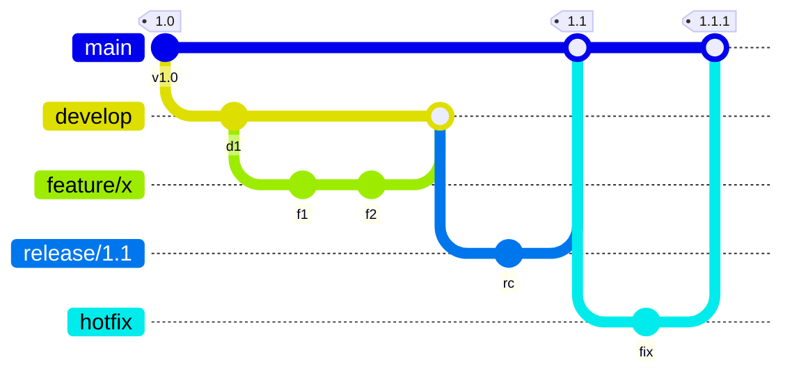
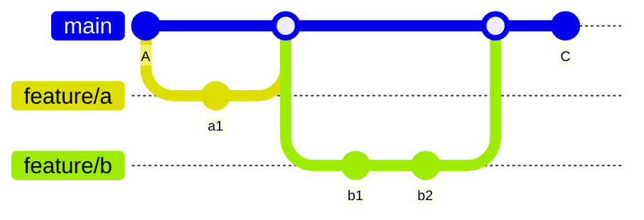

# Branching models

---
layout: default
label: 10 · Branching models
---

# GitFlow keeps a branch per release stage

<!--
GitFlow has five kinds of branches: main for released code, develop for integration, feature branches, release branches to stabilise a version, and hotfix branches for urgent fixes. It fits software that ships numbered versions and maintains several of them at the same time.
-->

---
layout: default
label: 10 · Branching models
---

# Trunk-based: one main, short branches

- One long-lived branch, `main`; short branches merged through a pull request

<!--
Here there is just main, called the trunk. Every change is a short branch of hours or a few days that goes back through a pull request quickly. Main is always in a state you can use. Large teams doing continuous delivery work like this, and so do many small teams.
-->

---
layout: default
label: 10 · Branching models
---

# Use trunk-based for scripts and analyses

<DmComparison
  class="mt-2"
  :rows="['Fits', 'Cost']"
  :cols="['GitFlow', 'Trunk-based']"
>
  <template #r0c0>Versioned products, several releases in support</template>
  <template #r0c1>Continuous delivery, scripts, analyses, small teams</template>

  <template #r1c0>Many branches, large merges, more conflicts</template>
  <template #r1c1>Discipline: small changes, review, tests</template>
</DmComparison>

<ul>
  <li><b>Use trunk-based</b>: short-lived <code>feature/...</code> branches and PRs; day 3 adds a branch protection rule on <code>main</code></li>
  <li>Exists, not today: <code>git cherry-pick</code>, <code>git stash</code></li>
</ul>

<b>Words you can now use</b> trunk-based · GitFlow · feature branch · short-lived · branch protection rule

<!--
The longer a branch lives, the larger the merge and the higher the chance of conflicts. GitFlow accepts that cost to support parallel releases, which analysis and tooling code rarely has. So we recommend trunk-based: small branches, pull requests, pull main often, delete branches after merging. Cherry-pick copies a single commit, stash parks uncommitted edits. We name them so you recognise the words; the Pro Git book covers them. A coding assistant will pick a branching approach for you unless you say what you want, so being able to say trunk-based, short-lived feature branch and pull request is what lets you direct it and judge the result.
-->

---
layout: statement
title: Questions - Git
---

# Questions?

The Git part

<!--
Pause here. Ask for questions on everything in the Git part: staging, commits, branches, merge, rebase, remotes and pull requests. Wait a few seconds longer than feels comfortable. If nobody asks, ask one person what was least clear.
-->
