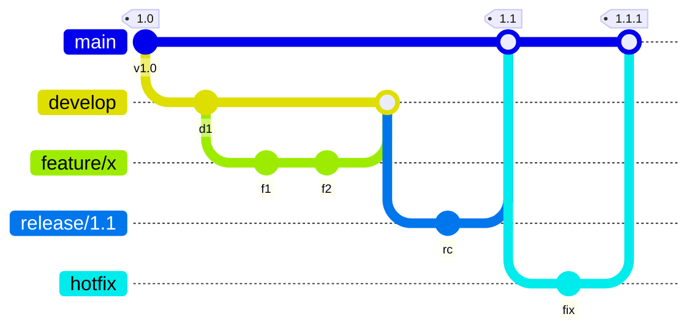
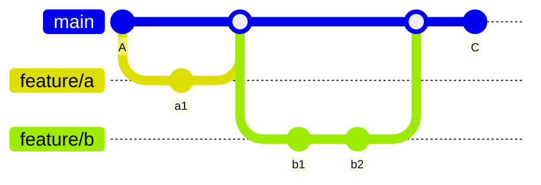

# Branching models

---
layout: default
label: 10 · Branching models
---

# Why a model?

- Git does not tell a team **how** to use branches
- Without agreement: long-lived branches, big merges, many conflicts
- A branching model answers: where does new work start, and where does it end up?
- Two well-known answers: GitFlow and trunk-based development

<!--
Git gives you the tools, not the rules. Teams need an agreement on where branches start, how long they live and how they are merged. We look at two common models and then pick one for this group.
-->

---
layout: default
label: 10 · Branching models
---

# GitFlow

<!--
GitFlow has five kinds of branches: main for released code, develop for integration, feature branches, release branches to stabilise a version, and hotfix branches for urgent fixes. It fits software that ships numbered versions and maintains several of them at the same time.
-->

---
layout: default
label: 10 · Branching models
---

# Trunk-based development

- One long-lived branch: `main`
- Short branches for hours or a few days, merged through a pull request

<!--
Here there is just main, called the trunk. Every change is a short branch that goes back through a pull request quickly. Main is always in a state you can use. Large teams doing continuous delivery work like this, and so do many small teams.
-->

---
layout: default
label: 10 · Branching models
---

# GitFlow versus trunk-based

<DmComparison
  class="mt-2"
  :rows="['Branches', 'Merges', 'Fits', 'Cost']"
  :cols="['GitFlow', 'Trunk-based']"
>
  <template #r0c0>main, develop, feature, release, hotfix</template>
  <template #r0c1>main plus short feature branches</template>

  <template #r1c0>Large, less often, more conflicts</template>
  <template #r1c1>Small and frequent</template>

  <template #r2c0>Versioned products, several releases in support</template>
  <template #r2c1>Continuous delivery, scripts, analyses, small teams</template>

  <template #r3c0>Many branches to keep in sync</template>
  <template #r3c1>Needs discipline: small changes, review, tests</template>
</DmComparison>

<!--
The main difference is how long work stays away from main. The longer a branch lives, the larger the merge and the higher the chance of conflicts. GitFlow accepts that cost to support parallel releases. For most analysis and tooling code, you do not have parallel releases.
-->

---
layout: default
label: 10 · Branching models
---

# Our recommendation

<DmSteps dir="vertical">
<DmStep n="1" label="Trunk-based">One long-lived branch, <code>main</code>, always working.</DmStep>
<DmStep n="2" label="Short-lived branches">One branch per small change, named <code>feature/...</code> or <code>fix/...</code>.</DmStep>
<DmStep n="3" label="Pull requests">Merge into <code>main</code> only through a reviewed PR.</DmStep>
</DmSteps>

On day 3 we protect <code>main</code> with a branch policy so this is enforced.

<!--
For compressor engineering scripts and analyses, trunk-based with short branches and pull requests is the best fit. It is simple to explain, has few conflicts, and works with the pipelines we build on day 3. If a branch lives longer than a few days, split the work or merge main into it regularly.
-->

---
layout: default
label: 10 · Branching models
---

# Habits that make it work

- Keep changes **small**: one idea per branch, one reviewer-friendly PR
- Pull `main` often, and before you start a new branch
- Delete the branch after the PR is completed
- Do not commit to `main` directly, even when you could
- Talk to your colleague before you both edit the same file

<!--
These habits matter more than the exact model. Small branches merge easily. Frequent pulls mean you start from current code. The last point is simple and prevents most conflicts: if two people are about to change the same function, a short chat saves an hour.
-->

---
layout: default
label: 10 · Branching models
---

# Exists, not today

<DmColumns class="mt-4">
<DmColumn header="git rebase" tone="navy">

Replay your commits on top of the latest `main` for a straight history.

</DmColumn>
<DmColumn header="git cherry-pick" tone="violet" divider>

Copy a single commit from one branch to another.

</DmColumn>
<DmColumn header="git stash" tone="navy" divider>

Park uncommitted edits and bring them back later.

</DmColumn>
</DmColumns>

Resolving large conflicts and release strategies come later, when you need them.

<!--
Name them so that people recognise the words in tutorials or from colleagues. Stash is the one that people tend to need first: you are mid-edit and need to switch branch. We do not practice any of these today. The Pro Git book on the wrap-up slide covers all three well.
-->
